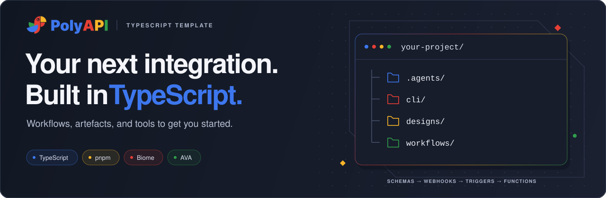

# PolyAPI TypeScript Project Template



Generic TypeScript workspace for PolyAPI workflow projects.

The template keeps deployable workflow code under `workflows/src/` and uses a
workspace-local Flow CLI under `cli/` to validate and sync TypeScript functions
and JSON artefacts to PolyAPI.

> **New to PolyAPI?** Start with the
> [sample workflow tutorial](workflows/src/sampleWorkflow/README.md).
> It walks through the core runtime flow from webhook to trigger to functions.

## Table of contents

| I want to… | Start here |
| --- | --- |
| Start a project | [Setup](#setup): [Getting started](#getting-started) · [Manual setup](#manual-setup) |
| Explore the workspace | [Structure](#structure) · [Conventions](CONVENTIONS.md) |
| Build and test a workflow | [Commands](#commands) · [Adding a workflow](#adding-a-workflow) |
| Work with Flow | [Flow CLI](#flow-cli) · [Add or update the Flow CLI](#add-or-update-the-flow-cli-in-your-project) |
| Train API Functions | [OpenAPI training](#openapi-training) |
| Set up coding agents | [Agent skills](#agent-skills) · [Repository instructions](AGENTS.md) |

## Structure

```text
poly-ts-project-template/
  .agents/    repository-local agent configuration and guidance
  cli/        workspace-local Flow validation and synchronization CLI
  designs/    upstream specifications and design source material
  kickstart/  interactive project bootstrap scripts
  workflows/  deployable workflows, shared utilities, and runtime tests
```

See [CONVENTIONS.md](CONVENTIONS.md) for the authoritative workflow layout,
artefact folders, naming rules, namespace behavior, and test placement.

## Setup

### Getting started

Getting started is straightforward. Run this command and follow the prompts
to bootstrap the project locally:

```bash
git clone git@github.com:polyapi/poly-ts-project-template.git && ./poly-ts-project-template/kickstart/kickstart.sh
```

Requires GitHub SSH access to the template and skills repositories, Git,
Node.js, pnpm, and the VS Code `code` command. GitHub CLI (`gh`) is not required.
Kickstart configures PolyAPI, saves the verified environment ID as
`TARGET_ENV_ID`, builds Flow, and opens the new project in VS Code.
It installs general, common, and TypeScript skills into `.agents/skills/`,
including the dedicated `api-function-training` skill.

### Manual setup

These steps are only needed if you did not use kickstart. If you used
kickstart, your project is already configured and you can skip this section.

Install dependencies:

```bash
pnpm install
```

To update the workflow SDK for your environment, use pnpm before running setup
or generation. For example, for `eu1`:

```bash
pnpm --filter workflows add polyapi@eu1
```

Use `na1` or `na2` for those environments, and `develop` for `dev`. If the Poly
CLI offers to update using npm, decline and use the pnpm command above; npm
cannot install this project's `workspace:*` dependency.

Set up PolyAPI environment

```bash
pnpm workflows exec poly setup
pnpm workflows exec poly generate
```

Create a local environment file from the sample:

```bash
cp workflows/dev.env.example workflows/dev.env
```

Keep the project namespace and target environment pin in your environment file:

```env
POLYAPI_NAMESPACE=mycustomer
TARGET_ENV_ID=replace-with-environment-id
```

Flow reuses the base URL and API key saved by `pnpm workflows exec poly setup`.
You only need to add `BASE_URL` and `API_KEY` to the selected environment file
if you want to override that saved connection, for example for a different
environment selected through `ENVPATH`.

For manual setup or an existing project, obtain the ID from your configured
connection:

```bash
pnpm flow target-env
```

Copy the printed `TARGET_ENV_ID=<id>` into the selected environment file after
checking it is the intended target. Kickstart does this automatically. Flow
checks the file's pin against authenticated `GET /whoami` before remote commands,
including deployment dry runs, training, deletion previews, and logs. A
mismatched key is rejected even when both environments use the same base URL.
Exporting a pin in the shell does not replace the file's pin. Offline training
dry runs and help do not need a pin or connection.

Once the values in `workflows/dev.env` are configured, preview deployment:

```bash
ENVPATH=workflows/dev.env pnpm workflows push --dry-run
```

Choose one root namespace for locally managed project artefacts. The checked-in
template uses `example`; replace it consistently when adopting the template.
See [Namespaces And Portable References](CONVENTIONS.md#namespaces-and-portable-references)
for what must use that namespace and which public or tenant references must not
be rewritten.

Find any placeholders that remain before the first deployment:

```bash
rg -n '\bexample\b' workflows/src
```

Do not commit real environment files or secrets.

## Add Or Update The Flow CLI In Your Project

If your project already uses this template structure and you want to add the
latest workspace-local Flow CLI, sync it from the current
`poly-ts-project-template` repository.

1. Clone the template repository, or update your existing local copy so you have
  the latest `poly-ts-project-template` code.
2. Remove the `cli/` folder from your target project.
3. Copy the `cli/` folder from `poly-ts-project-template` into your target
  project.
4. Replace the target project's `pnpm-lock.yaml` with the one from
  `poly-ts-project-template`.
5. Copy `package.json` from `poly-ts-project-template` into your target
  project.
6. Remove `package-lock.json`.
7. Remove installed dependencies and reinstall everything so the CLI and its
  generated files are rebuilt cleanly.
8. Push the changes. Use a normal push for regular updates, or `--force` when
   you need to fully overwrite the deployed state.

```bash
rm -rf node_modules
rm -rf cli/node_modules
pnpm install
pnpm --filter flow-cli build
pnpm workflows push
# or force a full update
pnpm workflows push --force
```

If your project did not originally come from this template, also make sure it
still includes the root workspace configuration and scripts that reference the
`flow-cli` package.

## Commands

Root commands:

```bash
pnpm check
pnpm format
pnpm lint
pnpm test
ENVPATH=workflows/dev.env pnpm test:integration
```

Workflow commands:

```bash
pnpm workflows test
ENVPATH=workflows/dev.env pnpm workflows test:integration
ENVPATH=workflows/dev.env RUN_MUTATING_INTEGRATION=true pnpm workflows test:integration:mutating
pnpm workflows test:all
pnpm workflows push
pnpm workflows push:dry-run
pnpm flow train-openapi
pnpm flow delete-content --dry-run
pnpm flow logs <function-id>
```

CLI commands:

```bash
pnpm flow build
pnpm flow generate
```

## Adding A Workflow

Follow the workflow layout, namespace rules, artefact guidance, and test
placement in [CONVENTIONS.md](CONVENTIONS.md). Start from the closest maintained
sample under `workflows/src/`, then run the checks and dry-run commands listed
there before deployment.

## Flow CLI

The Flow CLI validates and synchronizes the artefact types documented in
[CONVENTIONS.md](CONVENTIONS.md#artefacts). It supports scoped `--paths` and
`--types` pushes, dry runs, production safeguards, and explicit orphan
deletion. See [cli/README.md](cli/README.md) for its command and payload
reference.

Flow also provides OpenAPI training, scoped content deletion, and function logs:

```bash
pnpm flow train-openapi designs/ --context 'demo.apis.{file}'
pnpm flow delete-content --types api-functions,schemas --context demo.apis
pnpm flow logs <function-id> --keyword error
```

These commands use the same Flow environment configuration (`ENVPATH` when
specified). Training and deletion retain branch/environment and production
confirmations. Deletion previews matching resources and requires typing
`DELETE`; use `--dry-run` to preview without deleting. The existing
`pnpm workflows train:openapi` and `pnpm workflows delete:content` shortcuts
remain available and now invoke Flow.

## OpenAPI Training

Put upstream specs under `designs/` or a workflow-local `artefacts/specs/`
folder, then run:

```bash
pnpm flow train-openapi
```

The script prompts for a spec file or folder and a PolyAPI context. Use `{file}`
in the context when each spec should train under a context based on its file
name.

You can also pass the spec path and `--context` directly. Add repeatable
`--operation-id ID` options to train only selected original operations and their
required schemas. Descriptions are converted from HTML to readable plain text;
the source specification stays unchanged.

Use `--generate-only` to review a generated `*.poly.json` before training it with
`pnpm flow train-model <model-file>`. Replacing a model requires
`--overwrite-model`. `--disable-ai`, `--rename FROM TO`, `--skip-generate`, and
`--dry-run` provide metadata, generation, and preview controls.

Preview resources for deletion:

```bash
pnpm flow delete-content --types api-functions,schemas --context demo.apis
```

This selects the exact context by default; add
`--include-children` for descendants and `--apply` for confirmed deletion.
Every deletion is verified. Existing colon command aliases remain supported.
See the [Flow CLI reference](cli/README.md#openapi-training) for details.

## Agent Skills

Kickstart installs the general, common, and TypeScript skill folders into
`.agents/skills/`, including `api-function-training` for OpenAPI/Swagger training.
It requires that skill to be available on `poly-skills/main`.

For manual setup, bring relevant skills into `.agents/skills/` from:

<https://github.com/polyapi/poly-skills>

For a TypeScript PolyAPI project, see the recommended skill setup in the
[sample workflow tutorial](workflows/src/sampleWorkflow/README.md#recommended-agent-skills).

See [AGENTS.md](AGENTS.md) and [CONVENTIONS.md](CONVENTIONS.md) before making
workflow or tooling changes.
