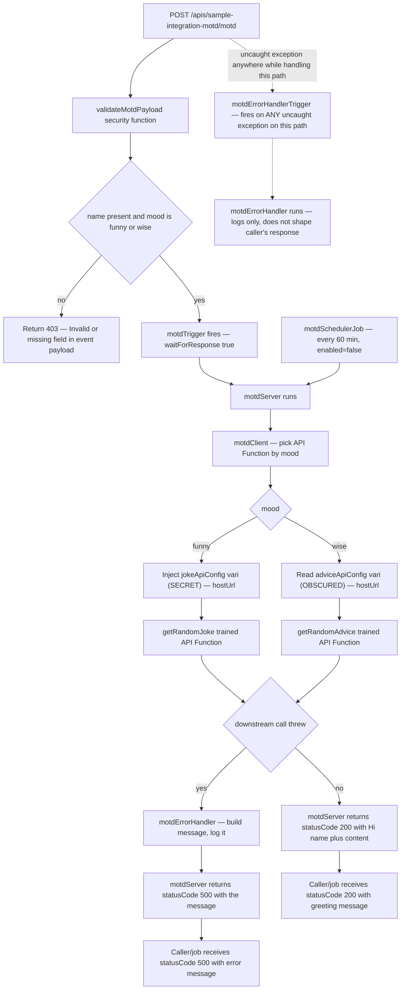

# Sample Integration

## Purpose

A small, self-contained example for learning core PolyAPI constructs
(webhook, trigger, server function, client function, trained API Function,
security function, error handler, vari, scheduled job) before working on a
real Boomi migration.
Not a Boomi migration — see the root
[`GETTING_STARTED.md`](../../../GETTING_STARTED.md) for how this fits into
the overall onboarding flow.

## Recommended Agent Skills

Before using AI agents to edit or extend this sample, add PolyAPI skills from
[polyapi/poly-skills](https://github.com/polyapi/poly-skills). They give
agents project-specific guidance for TypeScript, artefacts, SDK usage,
documentation, and PolyAPI constructs.

1.  Clone or update `poly-skills` outside this project.
2.  Create `.agents/skills/` in this project if it does not already exist.
3.  Copy each recommended skill directory below directly into
    `.agents/skills/` using the skill directory's own name. Do not copy package
    roots such as `poly-skills/polyapi-common/` or
    `poly-skills/polyapi-typescript/` into `.agents/skills/`, and do not
    preserve parent folders from below `skills/`.

Recommended TypeScript PolyAPI skills:

-   `poly-skills/general/skills/clean-code`
-   `poly-skills/general/skills/markdownlint-compliance`
-   `poly-skills/polyapi-common/skills/canopy-ui`
-   `poly-skills/polyapi-common/skills/design-analysis`
-   `poly-skills/polyapi-common/skills/generate-overview`
-   `poly-skills/polyapi-common/skills/polyapi-constructs`
-   `poly-skills/polyapi-typescript/skills/artefacts-usage`
-   `poly-skills/polyapi-typescript/skills/coding-conventions`
-   `poly-skills/polyapi-typescript/skills/coding-standards`
-   `poly-skills/polyapi-typescript/skills/polyapi-sdk`

The destination stays flat. For example, copy
`polyapi-common/skills/canopy-ui/clean-code` to
`.agents/skills/clean-code`, not to
`.agents/skills/canopy-ui/clean-code`.

## Key Concepts

PolyAPI building blocks used in this sandbox, before you dive into the flow
below:

| Concept                  | What it is                                                                                                                                                                                                                                                                                                                                                                                                                                          |
| ------------------------ | --------------------------------------------------------------------------------------------------------------------------------------------------------------------------------------------------------------------------------------------------------------------------------------------------------------------------------------------------------------------------------------------------------------------------------------------------- |
| **Webhook**              | A public HTTP endpoint PolyAPI hosts for you (`artifacts/webhooks/`). Defines method, path, payload schema, and optional security functions.                                                                                                                                                                                                                                                                                                        |
| **Trigger**              | Wiring that connects an event source (a webhook, in this sandbox) to a destination function (`artifacts/triggers/`). Can run synchronously (`waitForResponse: true`) or fire-and-forget.                                                                                                                                                                                                                                                            |
| **Server function**      | TypeScript code deployed to and executed on the PolyAPI platform (`server/*.ts`). Can call other `poly.*` functions, vari, and client functions.                                                                                                                                                                                                                                                                                                    |
| **Client function**      | TypeScript code that also runs server-side but is meant as a reusable step called from server functions (`client/*.ts`) — here, `motdClient` picks which trained API Function to call.                                                                                                                                                                                                                                                              |
| **Trained API Function** | A typed `poly.*` wrapper generated from an OpenAPI spec (`pnpm workflows train:openapi`). Never throws on a downstream failure — it resolves with a non-2xx `status` and incomplete `data` instead.                                                                                                                                                                                                                                                 |
| **Security function**    | A function attached to a webhook's `securityFunctions` that runs _before_ the trigger fires and can veto the request (e.g. `validateMotdPayload`, returning a 403).                                                                                                                                                                                                                                                                                 |
| **Error handler**        | A function that normalizes and logs a failure. This sandbox uses it two ways at once: called directly from a server function's `catch` block (for response shaping, scoped to that one call site), and wired as the destination of a platform error-handler trigger scoped to a webhook `path` (a broader, fire-and-forget safety net that catches _any_ function's uncaught exception on that path) — see [Error handler](#flow-motdserver) below. |
| **Vari**                 | A platform-managed variable (`artifacts/vari/`) with a secrecy level (`NONE`, `OBSCURED`, `SECRET`, `PARTIAL`) controlling how code and humans can read it. This sandbox demonstrates two levels — see the vari table below.                                                                                                                                                                                                                        |
| **Scheduled job**        | A cron-like definition (`artifacts/jobs/`) that calls a destination function directly on an interval, with no webhook or trigger involved.                                                                                                                                                                                                                                                                                                          |

## Environment Setup

Before deploying this sandbox, make sure Node.js and pnpm are installed. If
you already completed the root
[`GETTING_STARTED.md`](../../../GETTING_STARTED.md) setup, skip ahead to
[Flow: motdServer](#flow-motdserver).

You need two things installed:

-   **Node.js 18+ (20+ recommended)** — runs Flow, this repo's PolyAPI CLI,
    and is what lets you deploy and test this sandbox's TypeScript functions
    (`pnpm workflows push`, `pnpm workflows test`).
-   **pnpm** (this repo is pinned to `pnpm@10.0.0` via `packageManager` in
    `package.json`) — the package manager this workspace uses instead of npm.

### macOS

Install [Homebrew](https://brew.sh) first if you don't already have it — it's
the standard macOS package manager, and there's no built-in alternative:

```bash
/bin/bash -c "$(curl -fsSL https://raw.githubusercontent.com/Homebrew/install/HEAD/install.sh)"
```

Follow the prompts it prints at the end — on Apple Silicon Macs it will ask
you to add `brew` to your shell's `PATH` with a couple of extra commands, do
that before continuing. Then:

```bash
brew install node
corepack enable
corepack prepare pnpm@10.0.0 --activate
```

### Windows

Check whether you already have [winget](https://learn.microsoft.com/en-us/windows/package-manager/winget/)
by opening PowerShell and running `winget --version`. It ships built in on
Windows 11 and recent Windows 10 updates. If it's not recognized, install the
**App Installer** package from the Microsoft Store (search "App Installer")
— that provides `winget`.

Then, from PowerShell or Command Prompt:

```powershell
winget install OpenJS.NodeJS.LTS --scope user
```

`corepack enable` needs script execution allowed first. **Open PowerShell as
Administrator** and run:

```powershell
Set-ExecutionPolicy -ExecutionPolicy RemoteSigned -Scope LocalMachine
```

When prompted, choose **[A] Yes to All**:

```text
Do you want to change the execution policy?
[Y] Yes  [A] Yes to All  [N] No  [L] No to All  [S] Suspend  [?] Help (default is "N"): A
```

Now finish setting up pnpm:

```powershell
corepack enable
corepack prepare pnpm@10.0.0 --activate
```

Close that terminal and switch to Git Bash for the rest of this guide.

### Verify your installation

```bash
node -v      # v18.x.x or higher
pnpm -v      # 10.0.0
```

### Get the project and install dependencies

```bash
git clone <this-repo-url> covetrus
cd covetrus
pnpm install
```

This is a pnpm workspace (see `pnpm-workspace.yaml`) with two packages:
`workflows` (the PolyAPI implementation, including this sandbox) and `cli`
(Flow, the sync tool). `pnpm install` sets up both.

### Configure environment values

Copy the example environment file:

```bash
cp dev.env.example dev.env
```

`dev.env` stays at the repo root and holds both Boomi and PolyAPI
credentials — this sandbox only needs the `POLYAPI_*` values filled in, since
it never touches Boomi:

```env
POLYAPI_NAMESPACE="covetrus"
POLYAPI_BASE_URL="https://na2.polyapi.io"
POLYAPI_API_KEY=""
POLYAPI_TENANT_ID=""
```

Ask your lead for these values if you don't have them. `dev.env` is never
read directly by an agent — only by the runtime scripts and CLI commands
that need it.

Next, initialize the local PolyAPI CLI config used by tests and by
post-push SDK generation:

```bash
pnpm workflows exec poly setup
```

It stores your base URL and API key locally in a spot the `polyapi` package
resolves automatically, so the CLI and workflow tests can authenticate
without you having to reference the file directly.

You're now ready to deploy this sandbox through the same `pnpm workflows
push` command used for a real migration — see
[Deployment order](#deployment-order) below.

## Project Structure

```text
workflows/src/sampleIntegration/
  README.md                # this document
  artifacts/
    webhooks/              # public HTTP endpoint definitions — motdWebhook.json
    triggers/              # motdTrigger.json (webhook -> server function), motdErrorHandlerTrigger.json (path -> error handler)
    vari/                  # platform-managed variables — jokeApiConfig.json, adviceApiConfig.json
    jobs/                  # scheduled job definitions — motdSchedulerJob.json
    specs/                 # OpenAPI specs trained into API Functions, plus the trained model output
  server/
    motdServer.ts          # orchestrator - entrypoint for both the webhook and the scheduler
    validateMotdPayload.ts # security function wired onto motdWebhook
    motdErrorHandler.ts    # error handler — called directly by motdServer's catch block, and by motdErrorHandlerTrigger
  client/
    motdClient.ts          # reusable step called by motdServer - picks a trained API Function by mood
```

Each `.ts` file under `server/` and `client/` has a matching `.json` with
the same metadata as its `polyConfig` export. This sandbox has no
`artifacts/schemas/` or `artifacts/tabi/` folder, since it validates its
payload inline in `validateMotdPayload` and keeps no persisted state — see
`submitOrderProcessCore` and `concurNetsuiteInvoices` for real examples of
those.

## Components Diagram

```mermaid
graph LR
    WH["motdWebhook<br/>(webhook)"]
    SEC["validateMotdPayload<br/>(security function)"]
    TR["motdTrigger<br/>(trigger)"]
    JOB["motdSchedulerJob<br/>(job)"]
    SF["motdServer"]
    CF["motdClient"]
    ERR["motdErrorHandler<br/>(error handler)"]
    V1["jokeApiConfig<br/>(vari, SECRET)"]
    V2["adviceApiConfig<br/>(vari, OBSCURED)"]
    API1["getRandomJoke"]
    API2["getRandomAdvice"]

    WH -- security check --> SEC
    WH --> TR
    TR -- "waitForResponse: true" --> SF
    JOB -- "every 60 min" --> SF
    SF --> CF
    SF -- "on catch, direct call" --> ERR
    CF -- "mood: funny" --> API1
    CF -- "mood: wise" --> API2
    V1 -. ".inject('hostUrl')" .-> API1
    V2 -. ".get('hostUrl')" .-> CF

    ERRTR[["motdErrorHandlerTrigger<br/>path-scoped safety net<br/>(not wired to any one component)"]]
    class ERRTR aside
    classDef aside fill:#20232a,stroke:#888,stroke-width:1px,stroke-dasharray: 4 3;
```



This is a structural view — which files reference which. `motdErrorHandlerTrigger`
is drawn on its own, with no arrows to or from it, because it isn't wired to
any single component the way everything else here is — it's a platform
trigger scoped to the `/apis/sample-integration-motd/motd` path as a whole, so
it independently covers _any_ function invoked on that path
(`validateMotdPayload`, `motdServer`, and anything they call). It's a
fire-and-forget safety net and doesn't shape the caller's response — only
`motdServer`'s direct call to `motdErrorHandler` does that. For the runtime
request/scheduler flow, see the [Flow Diagram](#flow-diagram) below.

---

# Flow: motdServer

**Trigger:** [artifacts/webhooks/motdWebhook.json](artifacts/webhooks/motdWebhook.json)
(`POST /apis/sample-integration-motd/motd`) → [artifacts/triggers/motdTrigger.json](artifacts/triggers/motdTrigger.json)
→ [server/motdServer.ts](server/motdServer.ts)

**Entrypoint type:** webhook (synchronous — `waitForResponse: true`)

**Security function:** [server/validateMotdPayload.ts](server/validateMotdPayload.ts)
rejects requests missing `name` or with an invalid `mood` before the trigger
fires, returning a 403.

**Error handler:** [server/motdErrorHandler.ts](server/motdErrorHandler.ts),
wired two ways at once to demonstrate both PolyAPI error-handling
mechanisms:

1.  **Direct call** — `motdServer`'s own `catch` block calls it directly when
    `motdClient` throws (e.g. a downstream `getRandomJoke`/`getRandomAdvice`
    call failing). It builds one message from the error, logs it, and
    returns it; `motdServer` returns `{ statusCode: 500, message }` instead
    of re-throwing, so the caller always gets a consistent shape instead of
    the platform's raw `{ type, message, stack }` default for an uncaught
    exception. This is the only mechanism that shapes the caller's response.
2.  **Platform trigger** — [artifacts/triggers/motdErrorHandlerTrigger.json](artifacts/triggers/motdErrorHandlerTrigger.json)
    fires `motdErrorHandler` for any uncaught exception on the
    `/apis/sample-integration-motd/motd` path, independently of `motdServer`'s
    own `catch` block. It's scoped to the _path_, not to one function — it
    would also fire if `validateMotdPayload` threw instead of returning
    `false`, or from any other bug on that path that never reaches
    `motdServer`'s `catch`. It's a fire-and-forget safety net — it does
    **not** shape the caller's response, confirmed by testing. Since it's
    path-scoped, it can't cover the scheduler (which has no path at all).

Because this function now has two callers with different payload shapes,
`motdErrorHandler` treats its input fields as optional and falls back
gracefully — see the comment in
[server/motdErrorHandler.ts](server/motdErrorHandler.ts).

**Scheduler (second entrypoint):** [artifacts/jobs/motdSchedulerJob.json](artifacts/jobs/motdSchedulerJob.json)
calls `motdServer` directly, every 60 minutes, with a fixed payload
(`{ name: "Scheduler", mood: "wise" }`) — no webhook, trigger, or HTTP request
involved. Ships `enabled: false` so it does nothing until deliberately turned
on.

**Client function:** [client/motdClient.ts](client/motdClient.ts), called
from `motdServer` to pick a trained API Function by `mood`.

**Pre-trained API functions:** (see [artifacts/specs/](artifacts/specs/)):

-   `poly.covetrus.sampleIntegration.getRandomJoke` — trained from [artifacts/specs/jokeApi.yaml](artifacts/specs/jokeApi.yaml), model output at [artifacts/specs/official-joke-api.json](artifacts/specs/official-joke-api.json)
-   `poly.covetrus.sampleIntegration.getRandomAdvice` — trained from [artifacts/specs/adviceApi.yaml](artifacts/specs/adviceApi.yaml), model output at [artifacts/specs/advice-slip-api.json](artifacts/specs/advice-slip-api.json)

`motdClient` supplies each trained function's base URL from **vari** —
deliberately classified at two different secrecy levels here, even though
both are really just public API base URLs, to demonstrate how access differs
per level:

**Vari:**

-   `jokeApiConfig` — [artifacts/vari/jokeApiConfig.json](artifacts/vari/jokeApiConfig.json), `SECRET`, read via `.inject("hostUrl")` only
-   `adviceApiConfig` — [artifacts/vari/adviceApiConfig.json](artifacts/vari/adviceApiConfig.json), `OBSCURED`, read via `.get()`

## Flow Diagram



The dashed path is `motdErrorHandlerTrigger` — a platform-level safety net,
not part of the normal request flow above it. It's drawn from `S0` because
that's literally what it's configured against: its JSON artifact has no
`functionIds`, only `path: "/apis/sample-integration-motd/motd"` — the exact
same path as `S0`. It only matters if something throws in a way the
diagram's own boxes don't already handle (`D1`'s 403 check, or `motdServer`'s
`try/catch`), which shouldn't happen in normal operation.

## Deployment order

```bash
# 1. Train the API Functions (interactive — prompts for spec path and context)
pnpm workflows train:openapi
# spec path:   src/sampleIntegration/artifacts/specs
# context:     covetrus.sampleIntegration

# 2. Deploy vari, then client function, then server functions, then the
#    webhook/trigger artifacts, then the scheduler job (requires motdServer
#    to already exist — Flow syncs jobs last, so this is one command)
ENVPATH=dev.env pnpm workflows push -- --paths sampleIntegration
```

Enter the spec folder path and the context `covetrus.sampleIntegration` when
prompted. Once training succeeds, `getRandomJoke` and `getRandomAdvice` exist
as API Functions on the PolyAPI platform under that context, callable as
`poly.covetrus.sampleIntegration.getRandomJoke` / `getRandomAdvice` after the
next SDK regeneration.

After the push, set `jokeApiConfig`'s real `hostUrl` value once via Canopy UI
or the PolyAPI API — its JSON artifact ships with no `value` field since it's
`SECRET`, so the push alone doesn't populate it, and `motdClient`'s `"funny"`
path won't work until a human sets it. In Canopy, open the `jokeApiConfig`
vari, choose the **Object** type for its value, and enter:

```json
{ "hostUrl": "https://official-joke-api.appspot.com" }
```

`motdSchedulerJob` ships with `"enabled": false`. Flip it to `true` in
[artifacts/jobs/motdSchedulerJob.json](artifacts/jobs/motdSchedulerJob.json)
and redeploy only once you actually want it running on a schedule.

## Test it end-to-end

```bash
curl -X POST 'https://94021a50.na2.polyapi.io/apis/sample-integration-motd/motd' \
  --header 'Content-Type: application/json' \
  --header 'Authorization: Bearer <your-poly-api-key>' \
  --data '{ "name": "Ada", "mood": "funny" }'
```

```json
{ "statusCode": 200, "message": "Hi Ada! What did the beaver say to the tree? ... It's been nice gnawing you." }
```

Send `"mood": "wise"` to hit `getRandomAdvice` instead, or an invalid payload
(missing `name`, or a `mood` other than `funny`/`wise`) to see
`validateMotdPayload` reject it with a 403 before `motdServer` ever runs:

```json
{ "statusCode": 403, "message": "Invalid or missing field in event payload." }
```

A genuine runtime error — e.g. a downstream API Function call failing —
returns a `statusCode: 500` instead, built by `motdErrorHandler`:

```json
{ "statusCode": 500, "message": "motd request failed in motdClient: getRandomAdvice failed with status 500" }
```

This exercises `motdErrorHandler`'s **direct-call** path only:
`motdClient`'s own status check throws, `motdServer`'s `try/catch` catches
it before anything escapes to the platform, so `motdErrorHandlerTrigger`
never has anything to fire on. There's no safe way to deliberately test the
trigger itself without breaking `motdServer`'s own code first, so in
practice it's only ever exercised by a genuine, unexpected bug.

## Known gaps

-   `motdSchedulerJob` bypasses `validateMotdPayload` (see
    [Scheduler](#flow-motdserver) above) — expected, since a job's payload
    comes from its own config, not the public internet.
