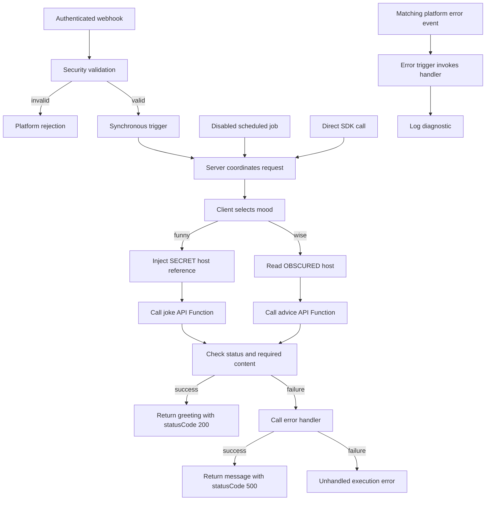
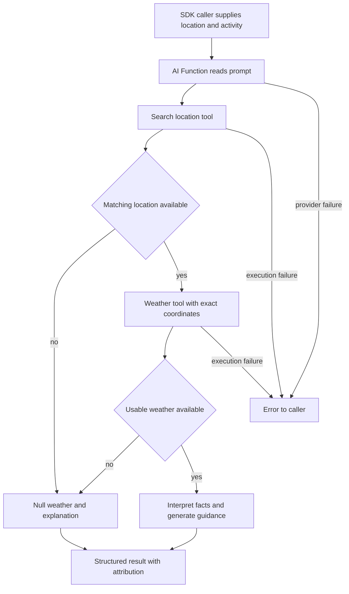

# Sample workflow runtime reference

Start with the [onboarding tutorial](README.md). This copy uses the `example`
namespace; keep its source, artefacts, and generated SDK calls aligned.

## Runtime reference

The remaining sections are reference material for understanding or extending
the working sample; they are not extra steps needed for your first request.

### Request and response



The [webhook](artefacts/webhooks/motdWebhook.json) hosts
`POST /apis/sample-workflow-motd/motd`, requires a PolyAPI key, and declares the
payload schema. Its [security function](server/validateMotdPayload.ts) returns
`false` when the name is missing or blank, or the mood is not `funny` or `wise`.
PolyAPI constructs the rejection response before the trigger fires.

The [trigger](artefacts/triggers/motdTrigger.json) uses `waitForResponse: true`
to return the server's result to the caller. The
[server](server/motdServer.ts) accepts one `eventPayload` argument and calls
[motdClient](client/motdClient.ts) through the generated SDK. A client function
runs in its caller's process; here its logs belong to `motdServer`, with no
separate hosted client execution or log stream.

The installed SDK returns API HTTP/transport failures as results with `status`
and `data`. The client checks for a 2xx status and the expected content:
`setup` / `punchline` for a joke, or `slip.advice` for advice. An unsuitable
result throws; the server's `catch` block handles that failure.

Each deployable `.ts` file carries its own `polyConfig` export. This sample has
no metadata sidecar JSON files or separate `artefacts/schemas/` folder: the
webhook declares its input schema. It keeps no persisted state and uses no Tabi
tables. See the [artefact conventions](../../../docs/CONVENTIONS.md#artefacts)
and platform [function types](https://docs.polyapi.io/functions/index.html) /
[client-function guide](https://docs.polyapi.io/generated_sdks/client_functions.html)
for the wider resource model and execution boundaries.

### Error handling

The [error handler](server/motdErrorHandler.ts) has two callers with different
payload shapes, so its input fields are optional. It uses the supplied function
name or `unknown function`, builds a message from the error detail, logs it,
and returns it.

When the client throws, the server calls this handler directly from its `catch`
block. If the handler succeeds, the server returns a body like:

```json
{ "statusCode": 500, "message": "motd request failed in motdClient: getRandomAdvice failed with status 500" }
```

`statusCode` is application data here. `motdServer` does not set
`polyCustom.responseStatusCode`, so a body containing `500` does not by itself
set HTTP status 500 or mark a scheduled execution as failed. This response
depends on the handler call succeeding; the handler's own failure remains
unhandled. Platform rejection and uncaught-error responses are separate.

The [error trigger](artefacts/triggers/motdErrorHandlerTrigger.json) independently
selects platform error events on `/apis/sample-workflow-motd/motd`. It has a
`path` filter and no `functionIds` filter. Its return value does not shape the
response produced by the server's direct handler call. Catching an SDK error
does not establish whether a remote error event was already emitted or whether
nested failures match that path. Verify matching and delivery in development;
see the [error-trigger guide](https://docs.polyapi.io/error_handlers/error-handler-trigger.html).

### Scheduled calls

The [job](artefacts/jobs/motdSchedulerJob.json) calls `motdServer` directly every
60 minutes with `{ name: "Scheduler", mood: "wise" }`. It ships with
`enabled: false`, so it does nothing until deliberately enabled and redeployed.
No webhook, webhook security check, or HTTP request participates in this path.
The server uses the supplied payload; its TypeScript type does not add runtime
validation to a direct call.

The server can call the error handler for a scheduled failure, just as it does
for a webhook request. A returned `statusCode: 500` is still application data;
the path-filtered platform error trigger does not establish coverage for the
scheduled entrypoint.

## Verification

Use the requests in [step 4](README.md#4-invoke-the-advice-path) and
[step 5](README.md#5-configure-injection-and-try-a-joke) to check both deployed
paths. Then send the invalid input from [Try it yourself](README.md#try-it-yourself) and confirm
that webhook security rejects it before the main server runs. Inspect the HTTP
status as well as the response body, and find `motdServer` in Canopy to view its
logs. The separate error handler has its own logs.

Local checks for the shared utilities and this sample's weather AI contracts
run with:

```bash
pnpm workflows test
```

The utility tests use mocked SDK calls, and the weather checks read the
checked-in artefact and specifications. They do not exercise this deployed
webhook or prove live secret resolution. The direct HTTP requests
above use the URL and key you provide, without Flow's `TARGET_ENV_ID` check.
Confirm both belong to the intended development environment.

To verify the platform error trigger, use a separate, deliberately failing
development fixture and inspect the handler's logs. A handled response alone
cannot establish whether a matching platform error event was delivered.

## Troubleshooting

| Symptom | Check |
| --- | --- |
| Generated function missing | Confirm training, namespace, and generation all used the same environment; inspect the translated names. |
| Target mismatch | Check the selected Flow file and connection against the intended environment; see [target pinning](../../../docs/SETUP.md#pin-the-target-environment). |
| Sample missing from the deployment preview | Remove its covering `POLY_DEPLOY_SKIP_PATHS` entry; `--paths` does not override exclusions. |
| `wise` works, `funny` fails | Set the SECRET Object value in Canopy and check the API Function's `hostUrl` argument. |
| Advice configuration error | Confirm the OBSCURED object contains a nonempty `hostUrl`. |
| Request rejected | Check the full deployed URL, matching key, nonblank name, and allowed mood. |
| Body contains `statusCode: 500` | Inspect the HTTP status and error-handler logs; check provider status and required fields. |
| Model already exists | Inspect and train the saved `.poly.json` model, or deliberately regenerate with `--overwrite-model`. |
| No client-function logs | Inspect the parent `motdServer` logs. The separate error handler has its own logs. |

## Training and SDK reference

The motd YAML specs' operation IDs declare the expected API names. Selecting those
operations avoids training other operations from the same specification.
Optional AI enrichment can change names, descriptions, and arguments; omit
`--disable-ai` only when you intend to review those changes. `--generate-only`
saves a translated model for review but still calls the platform and, unless
disabled, its AI enrichment service.

Use `train-model` to retry a saved `.poly.json` model. Regeneration from a spec
requires `--overwrite-model`; `--rename FROM TO` can align changed identifiers.
The older [official-joke-api.json](artefacts/specs/motd/official-joke-api.json) and
[advice-slip-api.json](artefacts/specs/motd/advice-slip-api.json) files are historical
reference models, not current training output or proof the functions exist in
your environment. See [Flow training](../../../cli/README.md#openapi-training).

Flow normally generates the SDK after successful training and pushes. For a
separate refresh, first confirm the native SDK connection, then run:

```bash
pnpm workflows exec poly generate
```

This native command uses the workflow SDK's selected connection. It does not
load Flow's `ENVPATH` or enforce `TARGET_ENV_ID`. Use the same environment as
training and deployment. After generation, open [motdClient](client/motdClient.ts)
and use **Go to Definition** on the two trained calls to inspect their names
and `hostUrl` arguments. If they are missing, check the training output and
model files before retrying. Change source specifications and regenerate rather
than editing generated declarations.

### Vari details

Vari secrecy levels control how code and humans can access a stored value.
The platform supports `NONE`, `OBSCURED`, `SECRET`, and `PARTIAL`; this sample
uses two levels to demonstrate the difference, even though both values are
public API base URLs.

The [joke config](artefacts/vari/jokeApiConfig.json) is SECRET. Its `.inject()`
reference must go unchanged into `getRandomJoke`; the API Function's gateway
boundary resolves it. A client function cannot resolve an injected value or
read the secret itself with `.get()`.

The [advice config](artefacts/vari/adviceApiConfig.json) is OBSCURED and starts
with `{ "hostUrl": "https://api.adviceslip.com" }`. It permits runtime reads
while masking the UI. Here `.get()` returns an object and the client reads its
`hostUrl` property on every request. Neither configuration nor the injection
reference is cached. Both upstream APIs are public and need no account or API key.

### Development branches

Kickstart creates `develop`. For a manual checkout, create it once from `main`
with `git switch -c develop main` if needed. To start a feature:

```bash
git switch develop
git switch -c feature/my-workflow
```

The default branch settings associate `develop` with `dev.env` and `main` with
`prod.env`. Flow checks branch ancestry and prompts when the selected file does
not match the branch's expected environment. Review the selected target and
preview instead of bypassing those checks; the selected file's verified target
pin still applies.

A full push also includes [common utilities](../utilities/common/OVERVIEW.md) and
this sample's [Weather AI](#weather-ai) Function. Configure their dependencies
before invoking them. Until the weather tools are trained, the AI Function's
tool references cannot resolve, so keep the tutorial's push scoped with its
explicit `--types` list. The common error trigger starts enabled; the sample job
starts disabled.

## Weather AI

Ask for current weather and practical advice for an activity. This lesson shows
how an AI Function combines **tool-provided facts**, **fixed configuration**, and
**generated guidance** in a structured result.

Complete [Getting started](../../../README.md#getting-started) first. If you are
new to API training and the generated SDK, start with
[Message of the day](README.md). Run commands from the project root in Bash or
zsh.

Coding-agent skills are optional for this lesson. Kickstart installs them;
manual checkouts can follow [agent skills setup](../../../docs/SETUP.md#agent-skills).

### What you will learn

The function accepts a required `location` and optional `activity`. It searches
for coordinates, asks a weather API for current conditions, then generates
activity-aware guidance. The tools use Open-Meteo and need no weather account or
API key for evaluation. The AI Function still requires configured OpenAI access
and can incur provider charges.

| Part of the lesson | Purpose | Source |
| --- | --- | --- |
| Location tool | Convert a place name into candidate coordinates | [Geocoding spec](artefacts/specs/weather/geocodingApi.json) |
| Weather tool | Fetch current conditions at the selected coordinates | [Weather spec](artefacts/specs/weather/weatherApi.json) |
| AI Function | Define inputs, prompt, allowed tools, fixed arguments, and result shape | [upliftingWeather](artefacts/ai-functions/upliftingWeather.json) |
| Contract tests | Check the local bindings and output schema | [Local tests](server/upliftingWeather.test.ts) |
| Runtime test | Invoke one deployed example and check its result | [Integration test](server/upliftingWeather.integration.test.ts) |

### Run the lesson

#### 1. Confirm the prerequisites

Use the target configured during setup and ask its administrator to confirm
OpenAI provider access and the model named in the AI artefact (`gpt-5.5`). If it
is not configured, use [provider setup](#provider-setup-reference) below before
invoking the function.

The context root must match `POLYAPI_NAMESPACE`. Kickstart updates the sample,
utilities, and copied tutorial examples to your chosen root. This copy uses
`example`. For a fresh manual checkout, run the namespace-alignment step in
[manual setup](../../../docs/SETUP.md#manual-setup) to update the starter code,
artefacts, and examples together. Changing the environment variable alone is
insufficient. For already-customized or deployed projects, follow
[namespaces and portable references](../../../docs/CONVENTIONS.md#namespaces-and-portable-references).

Select your setup-configured file once per terminal session:

```bash
export ENVPATH=workflows/dev.env
```

The commands below reuse this selection. TypeScript Flow also accepts
`export ENVPATH=dev.env`, looking in `workflows/` first. Its default without
`ENVPATH` is `workflows/dev.env`.

Keep the intended environment's `TARGET_ENV_ID` in that file. Kickstart saves
this pin; it is separate from your namespace and does not change your login.
See [target pinning](../../../docs/SETUP.md#pin-the-target-environment) for
manual setup or a mismatch. Before this lesson,
[align the SDK with your instance](../../../docs/SETUP.md#align-the-sdk-with-your-polyapi-instance);
kickstart already does this during project creation. Repeat it if Poly reports
a version mismatch.

Run the local contract checks:

```bash
pnpm workflows exec ava src/sampleWorkflow/server/upliftingWeather.test.ts
```

**Checkpoint:** these tests pass without credentials. They verify the checked-in
contracts, not the remote translator, model behavior, or weather accuracy.

#### 2. Train the weather tools

Preview the bundled specifications, then train them:

```bash
pnpm flow train-openapi workflows/src/sampleWorkflow/artefacts/specs/weather --context example.sampleWorkflow --disable-ai --dry-run
pnpm flow train-openapi workflows/src/sampleWorkflow/artefacts/specs/weather --context example.sampleWorkflow --disable-ai
```

The preview checks local inputs only. Real training verifies the target, saves
`.poly.json` models beside the specs, registers the tools, and regenerates the
SDK. `--disable-ai` skips optional metadata enrichment; it does not disable the
AI Function you will invoke later.

**Checkpoint:** inspect `geocodingApi.poly.json` and `weatherApi.poly.json` for
`searchLocations` and `getCurrentWeather` in your namespace. Match their argument
keys to the AI artefact. In particular, the weather binding expects
`temperatureUnit`, translated from the provider's `temperature_unit`. The
offline preview cannot prove that translation. To retry saved models or
deliberately regenerate them, follow [Flow training](../../../cli/README.md#openapi-training).

#### 3. Deploy the AI Function

If `POLY_DEPLOY_SKIP_PATHS` includes `src/sampleWorkflow` or a parent folder,
remove that entry in the selected environment file first. `--paths` does not
override it. See [skip sample deployments](../../../docs/SETUP.md#skip-sample-deployments)
for how to keep the lesson files while excluding them from normal pushes.

```bash
pnpm workflows push --dry-run --paths sampleWorkflow --types ai-functions
pnpm workflows push --paths sampleWorkflow --types ai-functions
```

Review the target and plan before the real push. Flow verifies the environment
for both commands and normally regenerates the SDK afterward. Both commands
resolve the two tools by exact name and context, so the preview fails if
training in step 2 did not register them. A deployment dry run does not invoke
the AI Function.

**Checkpoint:** Canopy and the generated SDK contain
`example.sampleWorkflow.upliftingWeather` under your chosen root, with `location`
and optional `activity` arguments. The function is enabled, its two tools resolve,
and the tenant's model provider is ready.

#### 4. Ask for weather guidance

This command makes a live AI and weather call. Confirm the generated SDK's
selected connection first: direct SDK calls do not load Flow's `ENVPATH` or
enforce its `TARGET_ENV_ID` check. Substitute your namespace in the call if it
differs from `example`:

```bash
pnpm workflows exec node <<'JS'
const poly = require('polyapi');

(async () => {
  const result = await poly.example.sampleWorkflow.upliftingWeather(
    'London, United Kingdom',
    'an outdoor walk'
  );
  console.log(JSON.stringify(result, null, 2));
})().catch(error => {
  console.error(error.message);
  process.exitCode = 1;
});
JS
```

An illustrative response follows. The numbers and prose are examples, not a live
weather report:

```json
{
  "location": "London, United Kingdom",
  "currentWeather": {
    "condition": "Partly cloudy",
    "temperature": 14,
    "unit": "C"
  },
  "description": "A light layer may help during your walk.",
  "recommendedItems": ["Light jacket", "Comfortable shoes"],
  "upliftingMessage": "Enjoy a change of scenery on your walk!",
  "attribution": "Weather data: Open-Meteo (https://open-meteo.com/), CC BY 4.0. Location data: GeoNames (https://www.geonames.org/). Guidance is AI-generated."
}
```

**Checkpoint:** the result follows the declared schema and includes attribution.
The location and weather fields should be grounded in tool data; the description,
items, and uplifting message are AI-generated interpretations. Compare the facts
with the tool results in the execution details. A valid schema alone does not
prove factual accuracy.

### How the AI contract works



In [the AI artefact](artefacts/ai-functions/upliftingWeather.json):

- `arguments` declares what callers supply. `inputTemplate` combines those inputs
  into a request; `systemPrompt` defines the behavior and failure instructions.
- `toolFunctions` limits the available tools. The AI selects search text and
  coordinates; fixed `hardcoded` bindings select provider hosts, Celsius, and
  weather fields.
- `outputSchema` requires `location`, `currentWeather`, `description`,
  `recommendedItems`, `upliftingMessage`, and `attribution`, with no extra keys.
- If no location or usable weather is found, the prompt requests null weather,
  an explanation, and no recommended items. Execution errors can still propagate
  instead of producing that result; callers should handle them.

An API Function wraps an HTTP API. This AI Function coordinates tools and
produces guidance. OpenAPI training and AI execution are separate operations.
This invocation uses the SDK directly; it does not use the message-of-the-day
webhook, server functions, or scheduled job. It has no Tabi state. The two
trained tools and the AI Function live in the project namespace; shared provider
configuration belongs outside its disposable resources.

Display attribution with the result. Open-Meteo weather is model-based current
estimates, not station observations, forecasts for a requested future date, or
official alerts. Its public API supports evaluation and non-commercial use;
review [the provider's terms and commercial plans](https://open-meteo.com/en/pricing)
before production use.

### Try it yourself

- Keep the location fixed and change the activity to cycling. Expect the same
  output structure and activity-specific guidance; current measurements can
  change between calls.
- Omit the second argument. The optional activity should not be necessary for a
  useful response. Confirm this behavior in your environment.
- Use an ambiguous place name, then add its country. Inspect how the resolved
  location changes and why the selected coordinates matter.
- Trace `temperatureUnit` from the weather spec through the translated model to
  its fixed binding. Changing that binding also requires aligning the prompt,
  output schema, and tests; a schema is part of the contract.
- Inspect the no-match instructions. A live exercise should check for null weather
  and empty items rather than assume the model obeyed the prompt.

### Verification and troubleshooting

After the manual call, the opt-in deployed test checks one London/outdoor-walk
response:

```bash
RUN_AI_INTEGRATION=true pnpm workflows test:integration
```

The flag is required because the call incurs provider usage. The test checks
the declared fields, nonempty text, non-null weather, Celsius, and attribution.
It does not check factual agreement with upstream measurements, no-match
behavior, or tool failures. The AVA runner uses the generated SDK's connection;
it does not load `ENVPATH` or check `TARGET_ENV_ID`.

| Symptom | Check |
| --- | --- |
| Sample missing from the deployment preview | Remove its covering `POLY_DEPLOY_SKIP_PATHS` entry; `--paths` does not override exclusions. |
| Tool or SDK name missing | Confirm the namespace, translated names, training, and SDK generation for the same target. |
| Tool cannot be resolved | Train both weather specs in the AI Function's context; names and contexts must match exactly. |
| Tool arguments rejected | Compare the translated model with each `argumentConfig` key, especially `temperatureUnit`. |
| Weather is null | Check the resolved location and tool results before treating it as a model problem. |
| Permission or provider error | Ask the administrator to check AI execution access and tenant provider configuration. |
| Generic server error | Correlate the AI execution ID and timestamp with gateway logs; a status alone does not establish the cause. |
| Provider authentication or quota error | Distinguish authentication, rate limiting, and exhausted quota before retrying. |

### Provider setup reference

The sample uses OpenAI through PolyAPI's tenant configuration. Provider setup and
permission to execute the AI Function are prerequisites; see the
[platform AI guide](https://docs.polyapi.io/ai_functions/index.html).

1. Have a tenant administrator store the OpenAI API key as a **SECRET string Vari**
   in the selected tenant, outside this sample's disposable namespace.
2. Set `OpenAITenantApiKey` to that Vari's UUID, not the provider key. Confirm the
   configuration name and update contract in the selected instance's Swagger
   before using `PATCH /tenants/{tenantId}/config-variables/OpenAITenantApiKey`
   with `{"value":"<SECRET_VARI_UUID>"}`. This procedure is outside Flow and the
   sample's tests; confirm its `ManageTenant`, user-key, and `x-otp` requirements.
3. Confirm the OpenAI project has credits and access to the configured model.

Keep the provider key in Vari, outside local env files and the AI artefact. The
Open-Meteo tools need no weather-provider secret.

For `403`, check execution permissions and tenant provider setup. For an upstream
`401`, check provider authentication. Distinguish a rate-limit `429` from a
quota/billing `429`; the latter needs account attention. See
[OpenAI's error guide](https://developers.openai.com/api/docs/guides/error-codes).
Exact gateway mappings depend on the target and are not verified by local tests.
Do not copy provider key fragments from logs into reports.

### Migrating the former AI sample

Earlier template versions shipped this lesson as a separate `sampleAiFx`
workflow whose AccuWeather tools needed a `weatherApiKey` SECRET. Moving local
files does not rename deployed resources: existing environments may still have
`upliftingWeather` and `weatherApiKey` under `example.sampleAiFx`. Train the
weather tools and deploy the AI Function in `example.sampleWorkflow`, regenerate
the SDK, and verify that invocation before separately reviewing cleanup of the
former context.

This source change does not delete remote resources. A full push reports the
former resources as orphans and deletes them only with `--delete-orphans`. To
preview just the former context, run
`pnpm flow delete-content --types ai-functions,variables --context example.sampleAiFx`;
it deletes nothing without `--apply`.

## Weather MCP server

Offer the same two weather tools to MCP clients, such as Claude, an IDE agent, or
the MCP Inspector. In the Weather AI lesson a PolyAPI-hosted model calls the
tools; here a model you do not control decides when to call them, and PolyAPI
runs each call with the bindings you fixed. No AI provider setup is needed.

### What this lesson covers

| Part of the lesson | Purpose | Source |
| --- | --- | --- |
| MCP server | Choose the tools, leave only the place and coordinates to the client, and fix hosts and units | [weatherTools](artefacts/mcp-servers/weatherTools.json) |
| Weather tools | The trained API Functions the Weather AI lesson also uses | [Geocoding spec](artefacts/specs/weather/geocodingApi.json), [weather spec](artefacts/specs/weather/weatherApi.json) |
| Contract tests | Pin the exposed tools, their bindings, and private visibility | [Local tests](server/weatherTools.test.ts) |

### Deploy and call the server

#### 1. Check the contract and train the tools

Select your Flow file as in [Weather AI step 1](#1-confirm-the-prerequisites),
then run the offline checks:

```bash
export ENVPATH=workflows/dev.env
pnpm workflows exec ava src/sampleWorkflow/server/weatherTools.test.ts
```

If you completed [Weather AI step 2](#2-train-the-weather-tools), the tools are
already trained. Otherwise, train them in the same environment:

```bash
pnpm flow train-openapi workflows/src/sampleWorkflow/artefacts/specs/weather --context example.sampleWorkflow --disable-ai
```

**Checkpoint:** the contract tests pass, and training lists `searchLocations`
and `getCurrentWeather` under `example.sampleWorkflow`.

#### 2. Deploy the server

If `POLY_DEPLOY_SKIP_PATHS` covers `src/sampleWorkflow`, remove that entry
first; see [skip sample deployments](../../../docs/SETUP.md#skip-sample-deployments).

```bash
pnpm workflows push --dry-run --paths sampleWorkflow --types mcp-servers
pnpm workflows push --paths sampleWorkflow --types mcp-servers
```

The preview should plan **Create** for `example-weather-tools`. MCP servers have
no namespace context, so Flow finds them by name, which must be unique in the
environment; kickstart names the server after your namespace. If the preview
plans **Update** although you never deployed it, another project uses that name:
stop and choose a different name before pushing.

**Checkpoint:** the push reports one created MCP server and prints its
`MCP URL: https://<instance>/mcp-servers/<id>/mcp`. Copy that URL.

#### 3. Connect a client

The server is private. PolyAPI rejects anonymous calls and PolyAPI keys for
private servers and accepts only OAuth sign-ins, which need an OAuth client this
lesson does not configure. To try the server, make it public briefly: while it
is public, anyone with its URL can call the two tools. They only read public
Open-Meteo data, and step 5 makes the server private again.

Set `"isPublic": true` in [weatherTools.json](artefacts/mcp-servers/weatherTools.json),
then push:

```bash
pnpm workflows push --paths sampleWorkflow --types mcp-servers
```

Flow warns that the server is public, and the plan updates only `isPublic`. The
contract tests fail while it is public; that is their job.

Start the [MCP Inspector](https://modelcontextprotocol.io/docs/tools/inspector):

```bash
npx @modelcontextprotocol/inspector
```

In the page it opens, choose the **Streamable HTTP** transport, paste the MCP
URL, and select **Connect**. Open **Tools** and select **List Tools**.

**Checkpoint:** two tools appear: `example_sampleWorkflow_searchLocations`, with
the input `name`, and `example_sampleWorkflow_getCurrentWeather`, with `latitude`
and `longitude`. The fixed hosts, result count, and units do not appear as
inputs: PolyAPI applies them.

#### 4. Call a sample tool

Select `example_sampleWorkflow_searchLocations`, enter `Bratislava` for `name`,
and run it. Then pass one result's latitude and longitude to
`example_sampleWorkflow_getCurrentWeather`.

Without the Inspector, curl makes the same calls. Replace the URL with yours:

```bash
MCP_URL='https://<instance>/mcp-servers/<id>/mcp'
mcp() { curl -s "$MCP_URL" -H 'Content-Type: application/json' -H 'Accept: application/json, text/event-stream' -d "$1"; echo; }
mcp '{"jsonrpc":"2.0","id":1,"method":"initialize","params":{"protocolVersion":"2025-06-18","capabilities":{},"clientInfo":{"name":"tutorial","version":"1.0.0"}}}'
mcp '{"jsonrpc":"2.0","method":"notifications/initialized"}'
mcp '{"jsonrpc":"2.0","id":2,"method":"tools/list"}'
mcp '{"jsonrpc":"2.0","id":3,"method":"tools/call","params":{"name":"example_sampleWorkflow_searchLocations","arguments":{"name":"Bratislava"}}}'
```

**Checkpoint:** the location search returns at most three matches, because the
server fixes `count` at 3, each with coordinates, such as Bratislava, Slovakia,
at about 48.15, 17.11.

#### 5. Make the server private again

Set `"isPublic": false`, confirm the contract, and push:

```bash
pnpm workflows exec ava src/sampleWorkflow/server/weatherTools.test.ts
pnpm workflows push --paths sampleWorkflow --types mcp-servers
```

**Checkpoint:** the same curl calls now return `403` with
`MCP server is private`.

### How the MCP server works

- The client's model chooses which tool to call and when. It sees each tool's
  name, which joins the context and function name with underscores and so shows
  your namespace, and the description trained from the spec. Improve a
  description in the spec before exposing a tool.
- Only `ai` arguments become tool inputs. PolyAPI applies `hardcoded` values
  without showing them, so the client cannot change the provider host or units.
- `toolFunctions` is the complete tool list: removing an entry removes the tool
  on the next push.
- Sharing a private server needs OAuth: set `oauthClientId` and
  `oauthClientSecretVariable` as described in
  [Flow's MCP reference](../../../cli/README.md#mcp-servers).
- Flow never deletes MCP servers. Delete `example-weather-tools` in PolyAPI when
  you no longer need it.

### Explore the MCP server

- Remove `getCurrentWeather` from `toolFunctions`, push while the server is
  public, and list the tools again: only the location search remains. The
  contract tests fail, flagging the narrowed tool surface in review. Restore
  the tool afterwards.
- Change the fixed `count` from 3 to 1, push, and repeat the location search.

### MCP troubleshooting

| Symptom | Check |
| --- | --- |
| `403` with `MCP server is private` | The server is private; follow step 3 to try it from a client. |
| `401` with `Invalid OIDC access token` | A PolyAPI key was sent as a bearer token; private servers accept only OAuth sign-ins. |
| Push stops: tool not found among API or server functions in this environment | Train the weather tools in the same environment, as in step 1. |
| Preview plans **Update** for a server you never deployed | Another project uses the name; rename the server before pushing. |
| Server still listed after you delete the artefact | Flow never deletes MCP servers; delete it in PolyAPI. |
