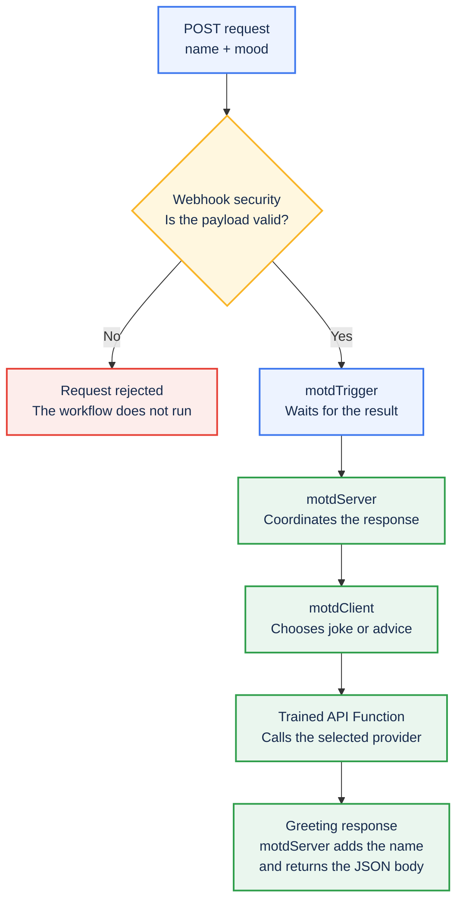
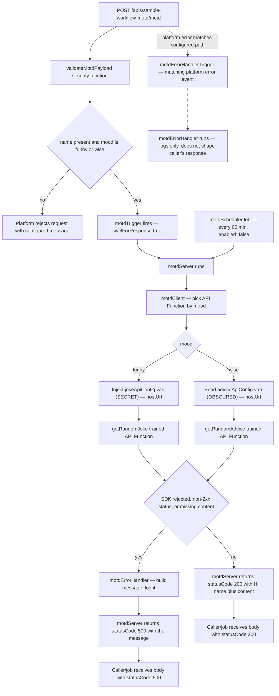

# Message of the day: your first PolyAPI workflow

Send a name and a mood, and get a greeting with a joke or advice. This tutorial
teaches how a webhook, trigger, server function, reusable client function, and
trained API Function work together. You will also use Vari, PolyAPI's stored
configuration values, and explore validation, error handling, and an optional
scheduled job.

Complete [Getting started](../../../README.md#getting-started) first. Then follow
one path from setup to a working request:

1. [Check your environment and namespace](#configure-environment-values).
2. [Train the two outbound APIs](#train-the-api-functions).
3. [Deploy the workflow](#deployment-order).
4. [Send a request and inspect the result](#test-it-end-to-end).
5. [Try the funny branch](#try-the-funny-branch) and
   [small changes](#try-small-changes), then explore the reference below.

The request you will build is:



**Flow** is the command-line tool that deploys this project's resources to
PolyAPI. The **generated SDK** is a TypeScript library built for your environment:
your code calls its functions through `poly.*` and reads its configuration
through `vari.*`. **Canopy** is the PolyAPI interface where you inspect deployed
resources, set configuration values, and view logs. The **PolyAPI runtime**
runs the endpoint and server functions. OpenAPI *training* registers an outbound
HTTP call as an API Function; this workflow does not invoke an LLM.

## Recommended Agent Skills

Skills are optional guidance for AI coding agents; you do not need an agent to
complete this tutorial. Kickstart already installs the recommended PolyAPI
skills. If you set up the project manually and want agent assistance, follow
[agent skills setup](../../../docs/SETUP.md#agent-skills) before editing.

## Configure environment values

Use a development environment with permission to manage the sample's resources,
generate its SDK, and execute its functions. The **project root** is the folder
containing this project's main `README.md`, `package.json`, `cli/`, and
`workflows/`. Run all terminal commands from that folder. The examples use Bash;
if your terminal uses another shell, run `bash` first. For an existing checkout,
follow [manual setup](../../../docs/SETUP.md#manual-setup).

**Terminal —** select your Flow environment file once for this session:

```bash
export ENVPATH=workflows/dev.env
```

Subsequent commands reuse that selection. TypeScript Flow also accepts
`export ENVPATH=dev.env`: a bare filename is looked up in `workflows/` first.
With no `ENVPATH`, Flow defaults to `workflows/dev.env`. Use `export`, so child
commands receive the setting; there is no need to source the file.

**File setting —** this tutorial assumes you're using `example` as your
namespace in the selected Flow file (`workflows/dev.env` here). Check the
setting in your editor; this block is file content, not a terminal command:

```env
POLYAPI_NAMESPACE=example
```

A namespace groups your project's functions and other resources in PolyAPI.
For example, `example.sampleWorkflow` belongs to the `example` namespace.
The code and commands in this tutorial must use the same namespace as your
environment file.

**Used kickstart?** This is already done. Kickstart sets your namespace and
updates the starter code and this tutorial to match. If you chose a different
name, you should see that name in the examples in your new project.

**Set up manually?** If you chose a different namespace, follow the namespace
step in [manual setup](../../../docs/SETUP.md#manual-setup) to update the starter
code and tutorial examples together. Changing only `POLYAPI_NAMESPACE` in
`dev.env` is not enough. For a project you have already customized, see the
[namespace rules](../../../docs/CONVENTIONS.md#namespaces-and-portable-references).

Your environment file also needs the `TARGET_ENV_ID` saved during setup. Flow
uses this ID to check that it is working with the right PolyAPI environment,
including when you preview a deployment. Keep real environment files out of Git.

**Checkpoint:** the namespace in your environment file matches the first part
of the sample's context (`example.sampleWorkflow`) and the namespace in its SDK
calls (`poly.example.sampleWorkflow` and `vari.example.sampleWorkflow`).

## Train the API functions

An OpenAPI specification describes an HTTP API. Training makes that API
available as functions your workflow can call. Train **both** YAML specifications
below: the client function refers to both APIs even though your first request
will use only advice. The folder also contains older JSON versions; selecting
the YAML files avoids processing duplicate APIs.

**Terminal — preview:** these two commands inspect the inputs without changing
your PolyAPI environment or writing generated files:

```bash
pnpm flow train-openapi workflows/src/sampleWorkflow/artefacts/specs/jokeApi.yaml --context example.sampleWorkflow --operation-id getRandomJoke --disable-ai --dry-run
pnpm flow train-openapi workflows/src/sampleWorkflow/artefacts/specs/adviceApi.yaml --context example.sampleWorkflow --operation-id getRandomAdvice --disable-ai --dry-run
```

Check that the output pairs `jokeApi.yaml` with `getRandomJoke` and
`adviceApi.yaml` with `getRandomAdvice`, both under `example.sampleWorkflow`
(or your chosen namespace). Each preview should report that no models were
written or trained. A **model** is the generated JSON description of the
resources PolyAPI will register.

**Terminal — train:** once those inputs are correct, register both APIs:

```bash
pnpm flow train-openapi workflows/src/sampleWorkflow/artefacts/specs/jokeApi.yaml --context example.sampleWorkflow --operation-id getRandomJoke --disable-ai
pnpm flow train-openapi workflows/src/sampleWorkflow/artefacts/specs/adviceApi.yaml --context example.sampleWorkflow --operation-id getRandomAdvice --disable-ai
```

Real training verifies the target, translates each spec, saves its model,
registers resources, and regenerates the SDK. `--disable-ai` skips optional
metadata enrichment and keeps the translator's names. Training does not call
the joke or advice provider.

**Checkpoint — files:** open these newly generated files in your editor. In
each file's `functions` array, check the function's `name` and `context`:

| Generated file, relative to the project root | Expected function name | Expected context |
| --- | --- | --- |
| `workflows/src/sampleWorkflow/artefacts/specs/jokeApi.poly.json` | `getRandomJoke` | `example.sampleWorkflow` |
| `workflows/src/sampleWorkflow/artefacts/specs/adviceApi.poly.json` | `getRandomAdvice` | `example.sampleWorkflow` |

**Checkpoint — SDK:** open [client/motdClient.ts](client/motdClient.ts) in your
editor and use **Go to Definition** on `getRandomJoke` and `getRandomAdvice`.
The expected calls are `poly.example.sampleWorkflow.getRandomJoke(hostUrl)`
and `poly.example.sampleWorkflow.getRandomAdvice(hostUrl)`. Each name should
resolve to its generated TypeScript declaration, with a `hostUrl` argument.
If either name cannot be resolved, check the training output and model files,
then repeat the SDK generation step in
[setup](../../../docs/SETUP.md#manual-setup) for the same environment before
continuing. An offline preview alone cannot generate these declarations.

If a model already exists, inspect it and use `train-model` on that saved
`.poly.json` to retry. Use `--overwrite-model` when intentionally regenerating
from a spec. The older `official-joke-api.json` and `advice-slip-api.json` files
are historical references, not the current training output or proof that the
APIs exist in your environment. See [Flow training](../../../cli/README.md#openapi-training).

## Deployment order

**Terminal — preview:** ask Flow to show the deployment plan for this workflow:

```bash
pnpm workflows push --dry-run --paths sampleWorkflow
```

Before deploying, check the displayed environment and namespace against your
setup. The plan should cover this sample's two variables, four functions, one
webhook, two triggers, and one disabled job. The job should stay disabled while
you learn the request flow.

**Terminal — deploy:** apply the reviewed plan:

```bash
pnpm workflows push --paths sampleWorkflow
```

Flow orders resources by dependency and refreshes the SDK after a successful
push. It does not train APIs from the specs folder during a push; that was the
previous step. Keep target-pin, branch, and OTP safeguards in place.

**Checkpoint:** in Canopy, select the same environment and confirm the resources
appear under `example.sampleWorkflow`. Your first request uses `wise`, which
reads the public host already stored in `adviceApiConfig`. You can configure the
joke branch's secret [after this first request](#try-the-funny-branch).

Leave `motdSchedulerJob` disabled while learning the request flow. Its optional
schedule is explained in the [runtime reference](#flow-motdserver).

## Test it end-to-end

In Canopy, select the environment used for deployment and open `motdWebhook`
under `example.sampleWorkflow`. Copy that webhook's **full URL**, rather than
constructing one from the path in its JSON file. These direct HTTP requests use
the URL and key you supply; they do not run Flow's target check.

**Terminal —** paste the URL and a PolyAPI API key for that environment when
prompted. The key is hidden while you enter it and is kept in this terminal
session; do not put it in the tutorial or commit it to a file:

```bash
read -r -p 'Full deployed webhook URL: ' MOTD_WEBHOOK_URL
read -r -s -p 'PolyAPI API key: ' MOTD_API_KEY
printf '\n'
```

Start with `wise`. **Terminal —** send the request; `curl -i` shows the HTTP
status as well as the JSON body:

```bash
curl -i -X POST "$MOTD_WEBHOOK_URL" \
  --header 'Content-Type: application/json' \
  --header "Authorization: Bearer $MOTD_API_KEY" \
  --data '{ "name": "Ada", "mood": "wise" }'
```

An illustrative response body is:

```json
{ "statusCode": 200, "message": "Hi Ada! <advice returned by the provider>" }
```

**Checkpoint:** the message starts with `Hi Ada!` and includes advice. Provider
text changes between calls. Find `motdServer` in Canopy to inspect its logs;
`motdClient` runs inside that server function and has no separate log stream.

You now have a working PolyAPI integration: a webhook request has reached your
workflow, called an external API, and returned a greeting. The remaining steps
explore validation and optional changes.

**Terminal —** in the same session, send a whitespace-only name:

```bash
curl -i -X POST "$MOTD_WEBHOOK_URL" \
  --header 'Content-Type: application/json' \
  --header "Authorization: Bearer $MOTD_API_KEY" \
  --data '{ "name": "   ", "mood": "wise" }'
```

**Checkpoint:** the security function rejects the request before `motdServer`
runs. The webhook supplies `Invalid or missing field in event payload.`;
inspect the platform's HTTP status and body rather than assuming the workflow's
normal response shape applies to a rejection.

## Try the funny branch

This optional step teaches secret injection. In Canopy, open `jokeApiConfig`
under `example.sampleWorkflow` in the same environment. Choose **Object** as
its value type and enter this value:

```json
{ "hostUrl": "https://official-joke-api.appspot.com" }
```

This URL is public, but the sample deliberately stores it as `SECRET` to teach
injection. Its JSON artefact has no value, so deploying it alone does not
populate the secret. The API Function receives the injected `hostUrl`; the
client function does not read the secret itself.

Run the first `curl` command again with `"mood": "funny"` and the original
`"name": "Ada"`. **Checkpoint:** the response still starts with `Hi Ada!`,
followed by a joke instead of advice. No source edit or redeployment is needed
to set this value in Canopy.

## Try small changes

| Exercise | What to observe | What it teaches |
| --- | --- | --- |
| [Try the funny branch](#try-the-funny-branch) after setting the secret. | A joke replaces the advice. | The client function chooses an API Function; SECRET uses injection. |
| Send `mood: "excited"`. | The security function rejects the request. | A TypeScript type alone is not runtime validation. |
| Read `motdSchedulerJob.json` without enabling it. | Its payload calls `motdServer` directly with `wise`. | Jobs have no webhook security check; this job starts disabled. |
| Follow the failure branch in `motdClient.ts`. | Non-2xx status or missing fields throws an error. | A returned API result still needs validation. |

When ready for recurring calls, deliberately enable the
[job artefact](artefacts/jobs/motdSchedulerJob.json) and redeploy it. It calls
`motdServer` every 60 minutes. This is optional, not needed to complete the
webhook tutorial.

### Change the greeting and redeploy

For one optional code change, open
[server/motdServer.ts](server/motdServer.ts) in your editor. In the successful
response, change only `Hi` to `Hello` so the existing line reads:

```typescript
message: `Hello ${eventPayload.name}! ${content}`,
```

Repeat the [deployment preview and push](#deployment-order), then send your
[first `wise` request](#test-it-end-to-end) again. **Checkpoint:** its message
now starts with `Hello Ada!`. This is how a local source edit reaches the
deployed function. Restore `Hi` and repeat the preview and deployment before
comparing the other tutorial checkpoints.

## How the files fit together

| Resource | Purpose in this workflow | Source |
| --- | --- | --- |
| Webhook and security function | Accept a request and reject invalid input. | [Webhook](artefacts/webhooks/motdWebhook.json), [validator](server/validateMotdPayload.ts) |
| Trigger | Route the accepted request and wait for its result. | [motdTrigger](artefacts/triggers/motdTrigger.json) |
| Server function | Coordinate the greeting and handled failure. | [motdServer](server/motdServer.ts) |
| Client function | Choose and validate an outbound API call. | [motdClient](client/motdClient.ts) |
| API Functions | Describe the downstream HTTP calls. | [Joke spec](artefacts/specs/jokeApi.yaml), [advice spec](artefacts/specs/adviceApi.yaml) |
| Vari | Supply configuration through injection or a read. | [SECRET joke config](artefacts/vari/jokeApiConfig.json), [OBSCURED advice config](artefacts/vari/adviceApiConfig.json) |
| Error handler and job | Explore alternate execution paths. | [Error handler](server/motdErrorHandler.ts), [error trigger](artefacts/triggers/motdErrorHandlerTrigger.json), [job](artefacts/jobs/motdSchedulerJob.json) |

## Checkpoints and troubleshooting

| Symptom | Next check |
| --- | --- |
| SDK name missing | Check namespace, successful training/deployment, and SDK generation for the same environment. |
| Target mismatch | Check the selected file and verified identity; do not bypass the pin. |
| `wise` works but `funny` fails | Check the SECRET Object value and the API Function's `hostUrl` argument. |
| Valid request rejected | Check the key, exact deployed URL, nonblank `name`, and supported `mood`. |
| Body contains `statusCode: 500` | Inspect the HTTP status and error-handler logs; check provider status and required response fields. |
| No client-function logs | Inspect the parent `motdServer` logs. The separate error handler has its own logs. |

A handled downstream failure produces a body like this if the error-handler
call succeeds:

```json
{ "statusCode": 500, "message": "motd request failed in motdClient: getRandomAdvice failed with status 500" }
```

`statusCode` is application data here. `motdServer` does not set
`polyCustom.responseStatusCode`, so a body containing `500` does not by itself
set HTTP status 500 or mark a scheduled execution as failed. Platform rejection
and uncaught-error responses are separate from this handled response.

To verify an error trigger, use a separate, deliberately failing development
fixture and inspect the handler's logs. A handled return is not proof that no
remote error event was emitted. The detailed reference below explains the two
error-handler paths and the sample's current limits.

## Key Concepts

Use this glossary when revisiting the detailed diagrams and runtime behavior:

| Concept | What it is |
| --- | --- |
| **Webhook** | A public HTTP endpoint PolyAPI hosts for you (`artefacts/webhooks/`). Defines method, path, payload schema, and optional security functions. |
| **Trigger** | Wiring that connects an event source (a webhook, in this sandbox) to a destination function (`artefacts/triggers/`). Can run synchronously (`waitForResponse: true`) or fire-and-forget. |
| **Server function** | TypeScript code (`server/*.ts`) deployed to and executed on PolyAPI. In this sample, it receives the event and coordinates the API call. |
| **Client function** | A same-language helper (`client/*.ts`) that runs in its caller's process: locally when called locally, or inside a server function when called there. It has no separate hosted execution. |
| **Trained API Function** | An outbound HTTP call registered from an OpenAPI spec and exposed through `poly.*`. The installed SDK converts HTTP/transport failures into a result with `status` and `data`; the sample checks both and throws when they are unsuitable. |
| **Security function** | A function attached to a webhook's `securityFunctions` that runs before the trigger fires. `validateMotdPayload` returns `false` to reject a request. |
| **Error handler** | A function called directly by `motdServer` to shape a failure response, and separately referenced by a path-filtered platform error trigger. These are distinct execution paths; see [Error handler](#flow-motdserver). |
| **Vari** | A platform-managed variable (`artefacts/vari/`) with a secrecy level (`NONE`, `OBSCURED`, `SECRET`, `PARTIAL`) controlling how code and humans can read it. This sandbox demonstrates two levels — see the vari table below. |
| **Scheduled job** | A cron-like definition (`artefacts/jobs/`) that calls a destination function directly on an interval, with no webhook or trigger involved. |

See the platform's [function types](https://docs.polyapi.io/functions/index.html)
and [client-function guide](https://docs.polyapi.io/generated_sdks/client_functions.html)
for execution boundaries and dependency rules.

## Project Structure

```text
workflows/src/sampleWorkflow/
  README.md                # this document
  artefacts/
    webhooks/              # public HTTP endpoint definitions — motdWebhook.json
    triggers/              # motdTrigger.json (webhook -> server function), motdErrorHandlerTrigger.json (path -> error handler)
    vari/                  # platform-managed variables — jokeApiConfig.json, adviceApiConfig.json
    jobs/                  # scheduled job definitions — motdSchedulerJob.json
    specs/                 # OpenAPI specs trained into API Functions, plus the trained model output
  server/
    motdServer.ts          # orchestrator - entrypoint for both the webhook and the scheduler
    validateMotdPayload.ts # security function wired onto motdWebhook
    motdErrorHandler.ts    # error handler — called directly by motdServer's catch block, and by motdErrorHandlerTrigger
  client/
    motdClient.ts          # reusable step called by motdServer - picks a trained API Function by mood
```

Each deployable `.ts` file carries its own `polyConfig` export. This sample
has no metadata sidecar JSON files, `artefacts/schemas/`, or `artefacts/tabi/`
folder: the webhook declares its payload schema, `validateMotdPayload` checks
inputs, and the workflow keeps no persisted state. See the
[artefact conventions](../../../docs/CONVENTIONS.md#artefacts) for other resource types.

## Components Diagram

```mermaid
graph LR
    WH["motdWebhook<br/>(webhook)"]
    SEC["validateMotdPayload<br/>(security function)"]
    TR["motdTrigger<br/>(trigger)"]
    JOB["motdSchedulerJob<br/>(job)"]
    SF["motdServer"]
    CF["motdClient"]
    ERR["motdErrorHandler<br/>(error handler)"]
    V1["jokeApiConfig<br/>(vari, SECRET)"]
    V2["adviceApiConfig<br/>(vari, OBSCURED)"]
    API1["getRandomJoke"]
    API2["getRandomAdvice"]

    WH -- security check --> SEC
    WH --> TR
    TR -- "waitForResponse: true" --> SF
    JOB -- "every 60 min" --> SF
    SF --> CF
    SF -- "on catch, direct call" --> ERR
    CF -- "mood: funny" --> API1
    CF -- "mood: wise" --> API2
    V1 -. ".inject('hostUrl')" .-> API1
    V2 -. ".get() then read hostUrl" .-> CF

    ERRTR[["motdErrorHandlerTrigger<br/>path-filtered platform errors"]]
    ERRTR -. "matching error event" .-> ERR
    class ERRTR aside
    classDef aside fill:#20232a,stroke:#888,stroke-width:1px,stroke-dasharray: 4 3;
```



This view shows resource references. `motdErrorHandlerTrigger` selects platform
error events using `/apis/sample-workflow-motd/motd` and names `motdErrorHandler`
as its destination. It is separate from the normal webhook trigger; its return
value is not used by `motdServer` to construct a response. For the request and
scheduler paths, see the [Flow Diagram](#flow-diagram).

---

## Flow: motdServer

**Trigger:** [artefacts/webhooks/motdWebhook.json](artefacts/webhooks/motdWebhook.json)
(`POST /apis/sample-workflow-motd/motd`) → [artefacts/triggers/motdTrigger.json](artefacts/triggers/motdTrigger.json)
→ [server/motdServer.ts](server/motdServer.ts)

**Entrypoint type:** webhook (synchronous — `waitForResponse: true`)

**Security function:** [server/validateMotdPayload.ts](server/validateMotdPayload.ts)
rejects requests missing `name` or with an invalid `mood` before the trigger
fires. The function returns a boolean; PolyAPI constructs the rejection response.

**Error handler:** [server/motdErrorHandler.ts](server/motdErrorHandler.ts),
wired two ways at once to demonstrate both PolyAPI error-handling
mechanisms:

1. **Direct call** — `motdServer`'s own `catch` block calls it directly when
    `motdClient` throws (e.g. a downstream `getRandomJoke`/`getRandomAdvice`
    call failing). It builds one message from the error, logs it, and
    returns it; `motdServer` returns `{ statusCode: 500, message }` instead
    of re-throwing. This response is produced only if the handler call itself
    succeeds; there is no second catch around that call.
2. **Platform trigger** — [artefacts/triggers/motdErrorHandlerTrigger.json](artefacts/triggers/motdErrorHandlerTrigger.json)
    selects errors matching `/apis/sample-workflow-motd/motd`; it has no
    `functionIds` filter. The platform delivers an error event separately from
    the direct call above. Do not assume every nested call inherits that path,
    or that catching an SDK error cancels an event already emitted remotely.
    Verify matching and delivery in your development environment using the
    [error-trigger guide](https://docs.polyapi.io/error_handlers/error-handler-trigger.html).
    This path filter does not establish coverage for the scheduled entrypoint.

Because this function now has two callers with different payload shapes,
`motdErrorHandler` treats its input fields as optional and falls back
gracefully — see the comment in
[server/motdErrorHandler.ts](server/motdErrorHandler.ts).

**Scheduler (second entrypoint):** [artefacts/jobs/motdSchedulerJob.json](artefacts/jobs/motdSchedulerJob.json)
calls `motdServer` directly, every 60 minutes, with a fixed payload
(`{ name: "Scheduler", mood: "wise" }`) — no webhook, trigger, or HTTP request
involved. Ships `enabled: false` so it does nothing until deliberately turned
on.

**Client function:** [client/motdClient.ts](client/motdClient.ts), called
from `motdServer` to pick a trained API Function by `mood`.

**API functions to train:** (see [artefacts/specs/](artefacts/specs/)):

- `poly.example.sampleWorkflow.getRandomJoke` — train from [artefacts/specs/jokeApi.yaml](artefacts/specs/jokeApi.yaml); [official-joke-api.json](artefacts/specs/official-joke-api.json) is a historical reference model.
- `poly.example.sampleWorkflow.getRandomAdvice` — train from [artefacts/specs/adviceApi.yaml](artefacts/specs/adviceApi.yaml); [advice-slip-api.json](artefacts/specs/advice-slip-api.json) is a historical reference model.

`motdClient` supplies each trained function's base URL from **vari** —
deliberately classified at two different secrecy levels here, even though
both are really just public API base URLs, to demonstrate how access differs
per level:

**Vari:**

- `jokeApiConfig` — [artefacts/vari/jokeApiConfig.json](artefacts/vari/jokeApiConfig.json), `SECRET`, read via `.inject("hostUrl")` only
- `adviceApiConfig` — [artefacts/vari/adviceApiConfig.json](artefacts/vari/adviceApiConfig.json), `OBSCURED`, read via `.get()`

The `.inject()` call creates a reference passed to the outbound API Function;
it does not reveal the secret to `motdClient`. Client functions cannot resolve
an injected value themselves. The API Function's gateway boundary resolves it.

## Flow Diagram



The dashed path is `motdErrorHandlerTrigger` — a platform-level safety net,
not part of the normal request flow above it. It's drawn from `S0` because
that's literally what it's configured against: its JSON artifact has no
`functionIds`, only `path: "/apis/sample-workflow-motd/motd"` — the exact
same path as `S0`. Its actual delivery depends on the platform error event,
not on the response body's `statusCode` field.

## Known gaps

- `motdSchedulerJob` and direct server-function calls bypass the webhook's
    `validateMotdPayload` check. `motdServer` has no equivalent input validation;
    its TypeScript type does not validate runtime inputs.
- There is no dedicated workflow test suite or deployed integration test for
    this TypeScript sample. The [kickstart regression tests](../../../kickstart/kickstart-namespace.test.cjs)
    exercise both moods and the error fallback with mocked SDK calls to check
    namespace wiring. `pnpm workflows test` covers other folders.
- The error handler returns/logs the supplied error detail and can itself fail.
    Review redaction and failure handling before adapting it for public use.
