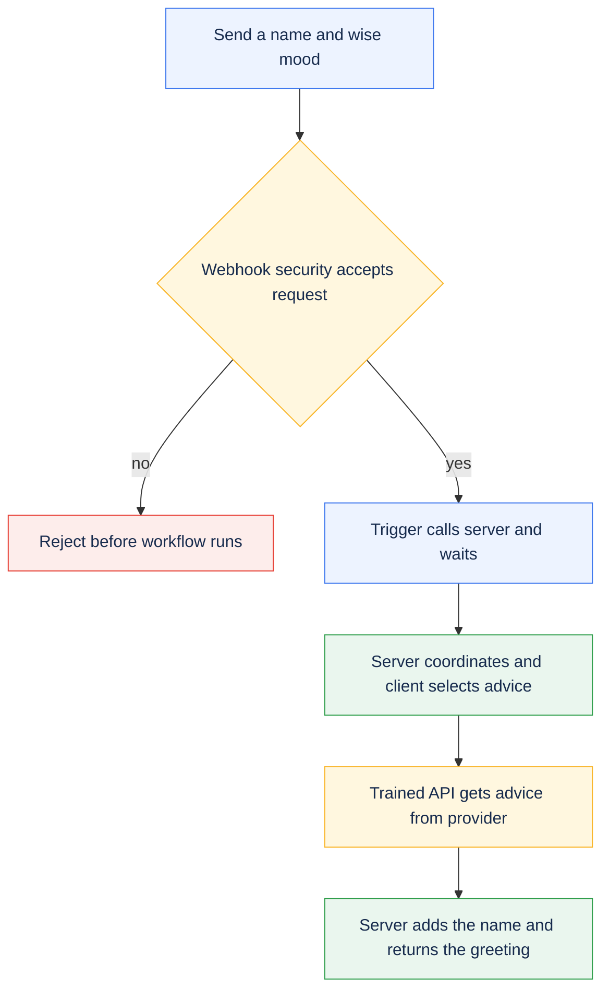

# Message of the day: your first PolyAPI workflow

Build a protected endpoint that greets someone with advice or a joke. This lesson
introduces webhooks, triggers, server and client functions, trained API Functions,
and Vari. After your first request works, explore validation, errors, and the
optional scheduled job.

New to the template? Complete [Getting started](../../../README.md#getting-started)
first. Open a Bash or zsh terminal in your **project root**: the folder containing
`package.json`, `cli/`, and `workflows/`. Run all terminal commands below from
that folder. File settings and Canopy values are labeled separately.

Using a coding agent? Kickstart installs the relevant skills. For a manual
checkout, follow [agent skills setup](../../../docs/SETUP.md#agent-skills) if you
want agent assistance. You can complete this lesson without an agent.

## PolyAPI foundations

A **tenant** contains **environments**, each with its own resource catalog. The
URL and API key select the actual target; local `dev.env` and `prod.env` filenames
are conventions. The namespace identifies the resources this project owns.
Read the [mental model](https://docs.polyapi.io/concepts/mental_model.html),
[resource guide](https://docs.polyapi.io/concepts/choosing-a-resource.html),
[environment guide](https://docs.polyapi.io/environments/ui.html), and
[TypeScript SDK guide](https://docs.polyapi.io/generated_sdks/typescript.html).

```text
workflows/src/sampleWorkflow/
  README.md                 First-request onboarding tutorial
  OVERVIEW.md               Runtime reference and optional weather AI lesson
  client/                   API selection and response validation
  server/                   Webhook/job handler, validation, error handler, and weather AI tests
  artefacts/
    specs/motd/             Joke and advice API descriptions
    specs/weather/          Geocoding and weather API descriptions
    vari/                   Configuration declarations, not real secrets
    webhooks/               Endpoint, inline payload schema, and security
    triggers/               Event-to-function connections
    jobs/                   Disabled scheduled invocation
    ai-functions/           Optional weather AI definition
```

Shared helpers live in `workflows/src/utilities/common/`; Flow lives in `cli/`.
A resource's context and name identify it on PolyAPI, independently of its local
filename. Each deployable TypeScript file carries its own `polyConfig`; call
other deployed functions through the generated SDK rather than relative imports.

## What you are building

Your first request follows the advice path:



**Flow** is this project's command-line tool for creating and updating resources
in PolyAPI. The **generated SDK** gives you TypeScript functions for those
resources, such as `poly.*` calls and `vari.*` configuration reads. **Vari** stores
configuration values; **Canopy** is the PolyAPI web interface used below to
manage them. The **PolyAPI runtime** hosts the endpoint and server functions;
client helpers run in their caller's process.

Here, **training an API** means reading its OpenAPI description and creating a
function that your code can call. Training does not call the external API, and
is separate from the [Weather AI lesson](OVERVIEW.md#weather-ai).

| Building block | Why it exists in this sample | Read the implementation |
| --- | --- | --- |
| Webhook and security function | Accept authenticated HTTP requests and reject invalid input | [Webhook](artefacts/webhooks/motdWebhook.json), [validator](server/validateMotdPayload.ts) |
| Trigger | Route the webhook to a function and wait for its result | [Webhook trigger](artefacts/triggers/motdTrigger.json) |
| [Server function](https://docs.polyapi.io/functions/server_functions.html) | Coordinate the request and choose the response | [motdServer](server/motdServer.ts) |
| [Client function](https://docs.polyapi.io/generated_sdks/client_functions.html) | Select an API by mood and check its result | [motdClient](client/motdClient.ts) |
| API Functions | Make the outbound joke/advice HTTP calls through PolyAPI | [Joke spec](artefacts/specs/motd/jokeApi.yaml), [advice spec](artefacts/specs/motd/adviceApi.yaml) |
| [Vari](https://docs.polyapi.io/vari_variables/code.html) | Demonstrate protected injection and readable configuration | [SECRET joke config](artefacts/vari/jokeApiConfig.json), [OBSCURED advice config](artefacts/vari/adviceApiConfig.json) |
| Error handler and job | Explore failure handling and scheduled calls | [Error handler](server/motdErrorHandler.ts), [error trigger](artefacts/triggers/motdErrorHandlerTrigger.json), [job](artefacts/jobs/motdSchedulerJob.json) |

Other supported resources include reusable schemas, **Tabi** structured tables,
**AI functions**, **Canopy** hosted applications, and **GraphQL subscriptions**.
This sample embeds its webhook schema inline, uses no Tabi table or subscription,
and adds weather AI only after the message workflow works. See the resource
guide above when choosing what your own integration needs.

## Run your first request

### 1. Confirm setup and namespace

Use a development environment with permission to manage the sample resources,
generate the SDK, and execute functions. `TARGET_ENV_ID` in the selected Flow
file pins the intended PolyAPI environment, separately from your namespace.
Kickstart saves it automatically; for manual setup, follow
[pin the target environment](../../../docs/SETUP.md#pin-the-target-environment).
The pin verifies your connection; it does not switch credentials.

**Align the SDK with your instance before continuing.** Kickstart does this
during project creation. For a manual or older checkout pointing to
`https://na1.polyapi.io`, run these commands from the project root:

```bash
pnpm --filter workflows add polyapi@na1
pnpm workflows exec poly setup
pnpm workflows exec poly generate
```

Use the [matching SDK tag](../../../docs/SETUP.md#align-the-sdk-with-your-polyapi-instance)
for another instance (`develop` for `dev`, or `na2` / `eu1`). Repeat SDK
alignment if Poly later reports a version mismatch. Decline its npm-based
update prompt and update with pnpm instead. The tag selects the SDK release;
setup selects the connection, and `TARGET_ENV_ID` verifies that connection.

This tutorial assumes you are using `example` as your namespace in
`workflows/dev.env`. **Check this setting in the file**, rather than entering it
as a terminal command:

```env
POLYAPI_NAMESPACE=example
```

A namespace groups your project's functions and other resources in PolyAPI.
The names in this tutorial must match that setting: for example,
`example.sampleWorkflow` belongs to the `example` namespace.

If you used **kickstart**, this guide and the sample files already use the
namespace you chose. You can continue with those values.

If you set up manually and chose a different namespace, follow the
[manual namespace setup](../../../docs/SETUP.md#manual-setup)
before continuing. It updates the starter code and tutorial examples to match.
Changing `POLYAPI_NAMESPACE` in `dev.env` alone does not update those files.
For an existing customized or deployed project, see
[changing a namespace](../../../docs/CONVENTIONS.md#namespaces-and-portable-references).

**In your terminal**, select your environment file once per session:

```bash
export ENVPATH=workflows/dev.env
```

Use your setup-selected file if different. TypeScript Flow also accepts
`export ENVPATH=dev.env`: it looks in `workflows/` first for a bare filename.
Without `ENVPATH`, it defaults to `workflows/dev.env`. Exporting the path selects
the file for Flow; it does not export that file's contents into your shell.

**Checkpoint:** the namespace in your environment file matches the first part
of the sample's context (`example.sampleWorkflow`) and its SDK calls
(`poly.example.sampleWorkflow` and `vari.example.sampleWorkflow`). Keep the
`TARGET_ENV_ID` saved during setup in that file. Flow checks it before remote
commands, including deployment previews. Keep real environment files out of Git.

### 2. Train the two outbound APIs

An OpenAPI specification describes an HTTP API. Training makes that API
available as functions your workflow can call. Train **both** bundled
specifications: the client function refers to both APIs even though your first
request will use only advice.

The `specs/motd/` folder also has older JSON reference files. Select the two
YAML specifications below to avoid processing duplicate APIs. The weather
specifications in `specs/weather/` belong to the optional
[Weather AI lesson](OVERVIEW.md#weather-ai).

**In your terminal**, preview the two bundled API descriptions:

```bash
pnpm flow train-openapi workflows/src/sampleWorkflow/artefacts/specs/motd/jokeApi.yaml --context example.sampleWorkflow --operation-id getRandomJoke --disable-ai --dry-run
pnpm flow train-openapi workflows/src/sampleWorkflow/artefacts/specs/motd/adviceApi.yaml --context example.sampleWorkflow --operation-id getRandomAdvice --disable-ai --dry-run
```

**Check the preview:** it should pair `jokeApi.yaml` with `getRandomJoke` and
`adviceApi.yaml` with `getRandomAdvice`, both under `example.sampleWorkflow`.
These commands check local inputs only; they do not create functions in PolyAPI.
Each preview reports that no models were written or trained.

**In your terminal**, register both APIs once the preview is correct:

```bash
pnpm flow train-openapi workflows/src/sampleWorkflow/artefacts/specs/motd/jokeApi.yaml --context example.sampleWorkflow --operation-id getRandomJoke --disable-ai
pnpm flow train-openapi workflows/src/sampleWorkflow/artefacts/specs/motd/adviceApi.yaml --context example.sampleWorkflow --operation-id getRandomAdvice --disable-ai
```

Real training verifies the target, translates each spec with a `hostUrl`
argument, saves its model, creates the API Functions, and regenerates the SDK.
`--disable-ai` skips optional AI-generated descriptions and names, retaining
the translator's names. Training does not call the joke or advice provider.

**Checkpoint — files:** these new files appear next to the original API
descriptions. A **model** is the generated JSON description of the resources
PolyAPI will register. Open each file in your editor and check the `name` and
`context` in its `functions` array:

| Generated file, relative to the project root | Expected function name | Expected context |
| --- | --- | --- |
| `workflows/src/sampleWorkflow/artefacts/specs/motd/jokeApi.poly.json` | `getRandomJoke` | `example.sampleWorkflow` |
| `workflows/src/sampleWorkflow/artefacts/specs/motd/adviceApi.poly.json` | `getRandomAdvice` | `example.sampleWorkflow` |

**Checkpoint — SDK:** open [motdClient](client/motdClient.ts) in your editor and
use **Go to Definition** on `getRandomAdvice` and `getRandomJoke`. The expected
calls are `poly.example.sampleWorkflow.getRandomAdvice(hostUrl)` and
`poly.example.sampleWorkflow.getRandomJoke(hostUrl)`. Each name should resolve to
its generated TypeScript declaration, with a `hostUrl` argument. An offline
preview alone cannot generate these declarations. See
[training and SDK reference](OVERVIEW.md#training-and-sdk-reference) if a name is
missing or models already exist when you retry.

### 3. Preview and deploy the workflow

Check `POLY_DEPLOY_SKIP_PATHS` in the selected Flow file. If it includes
`src/sampleWorkflow` (or a parent folder), remove that entry for this lesson;
otherwise Flow skips the sample even with `--paths sampleWorkflow`. See
[skip sample deployments](../../../docs/SETUP.md#skip-sample-deployments) to
exclude the lesson again afterward without deleting its files or resources.

Use a branch based on `develop`; see [development branches](OVERVIEW.md#development-branches)
if your checkout is not already configured. **In your terminal**, preview this
sample's deployment. The explicit resource types leave the optional weather AI
Function out until its tools and provider are configured:

```bash
pnpm workflows push --dry-run --paths sampleWorkflow --types functions,variables,schemas,webhooks,triggers,jobs
```

**Check the preview:** confirm the intended environment and namespace. The plan
should include the sample's two variables, four functions, webhook, two
triggers, and disabled job, with no AI Function. The job should stay disabled
while you learn the request flow.

**In your terminal**, deploy the workflow once the plan is correct:

```bash
pnpm workflows push --paths sampleWorkflow --types functions,variables,schemas,webhooks,triggers,jobs
```

Flow verifies the environment for both commands and normally regenerates the
SDK after deployment. It orders resources by dependency; a push does not train
APIs from the specs folder. Keep the branch, target, and OTP safeguards in place.

**Checkpoint:** deployment completes without errors. In Canopy, select the same
environment and confirm the resources appear under `example.sampleWorkflow`.
Your first request uses `wise`, which reads the public host already stored in
`adviceApiConfig`. You can configure the joke branch's secret
[after this first request](#5-configure-injection-and-try-a-joke).

### 4. Invoke the advice path

**In Canopy**, select the environment used for deployment and open the webhook
named `motdWebhook` under `example.sampleWorkflow`. Copy its **full URL**, including
the environment subdomain; do not build it from the gateway base URL or the path
in its JSON file. These direct HTTP requests use the URL and key you supply;
they do not run Flow's target check.

**In your terminal**, run these prompts. Paste the complete deployed webhook
URL and a PolyAPI key for that same environment, pressing Enter after each.
The key stays hidden while you enter it:

```bash
printf 'Paste the full deployed webhook URL: '
read -r POLY_TEST_WEBHOOK_URL
printf 'Paste the PolyAPI key for that environment: '
stty -echo; read -r POLY_API_KEY; stty echo
printf '\n'
```

These prompts work in both Bash and zsh (the macOS default).

These values stay in this shell session; do not save them in tracked files.
A value in an env file does not automatically become a shell variable.

**In your terminal**, send the request from the same session. `curl -i` shows
the HTTP status as well as the JSON body:

```bash
curl -i -X POST "$POLY_TEST_WEBHOOK_URL" --header 'Content-Type: application/json' --header "Authorization: Bearer $POLY_API_KEY" --data '{ "name": "Ada", "mood": "wise" }'
```

Expect a body with this shape; the advice text varies:

```json
{ "statusCode": 200, "message": "Hi Ada! <advice returned by the provider>" }
```

**Checkpoint:** the message starts with `Hi Ada!` and includes advice. Provider
text changes between calls. You have exercised webhook → security function →
trigger → server → client → trained API Function. Find `motdServer` in Canopy to
inspect its logs; `motdClient` runs inside that server function and has no
separate log stream. The advice configuration ships with its public host URL,
so this path needs no extra provider account or secret.

**Your first integration works.** You can stop here or continue below to learn
how to use secrets and change the sample.

### 5. Configure injection and try a joke

This is an optional next step after the advice request succeeds.

**In Canopy**, open `jokeApiConfig` under `example.sampleWorkflow` in the same
environment. Set its value as an **Object**. Paste this JSON as the variable's
value, not into your terminal:

```json
{ "hostUrl": "https://official-joke-api.appspot.com" }
```

This URL is public, but the sample deliberately stores it as `SECRET` to teach
injection. Its JSON artefact has no value, so deployment alone does not populate
it. The API Function receives the injected `hostUrl`; the client function does
not read the secret itself. See [Vari details](OVERVIEW.md#vari-details) for how
the two configuration values differ.

Repeat the request from [step 4](#4-invoke-the-advice-path) with
`"mood": "funny"` and the original `"name": "Ada"`. Expect a greeting that joins
a joke's setup and punchline:

```json
{ "statusCode": 200, "message": "Hi Ada! <setup> ... <punchline>" }
```

**Checkpoint:** `.inject("hostUrl")` passes an opaque reference to the API
Function. The platform resolves it at that boundary; the client never reads
the SECRET value.

## Try it yourself

These exercises are optional. Start with the small greeting change, then explore
the other behavior when you are ready.

- In [motdServer](server/motdServer.ts), change the greeting from
  `Hi` to `Hello`. Repeat the [deployment preview and push](#3-preview-and-deploy-the-workflow),
  then send the [advice request](#4-invoke-the-advice-path) again. You should now
  see `Hello Ada!` followed by the advice. Restore `Hi` and redeploy afterward
  so the response examples still match.
- Change `Ada` to your name and switch between `wise` and `funny`. Trace the two
  branches in [motdClient](client/motdClient.ts).
- Send a whitespace-only name or `"mood": "sleepy"`. Expect rejection before the
  main server runs; inspect both the HTTP status and the platform's response.
  The webhook supplies `Invalid or missing field in event payload.` as its
  rejection message.
- Explain why advice uses a read while the joke uses injection. Neither value
  is cached, and only one can be read by the client.
- Read the [scheduled job](artefacts/jobs/motdSchedulerJob.json). It calls the
  server directly every 60 minutes with `Scheduler` / `wise`, bypassing webhook
  security. Leave the job disabled unless you intend recurring calls.
- Follow the provider-failure branch in [motdClient](client/motdClient.ts) and
  the `catch` block in [motdServer](server/motdServer.ts). Observe how an invalid
  API result becomes a handled response through the error handler.

## Continue building

Follow the [optional weather AI lesson](OVERVIEW.md#weather-ai) in this same
workflow to train its public tools and confirm the AI provider. The core
webhook does not need that setup. The [runtime reference](OVERVIEW.md) covers
errors, scheduled calls, SDK generation, and verification.

Create a sibling workflow for your own integration, keeping its inline metadata,
artefacts, generated SDK calls, and tests aligned. Follow the
[project conventions](../../../docs/CONVENTIONS.md) and
[official tutorials](https://docs.polyapi.io/tutorials/index.html). Run
`pnpm check` and `pnpm workflows test`, review a development deployment preview,
and verify the deployed result before promoting. Review destructive cleanup
separately; never delete shared provider configuration with a disposable sample
namespace.
