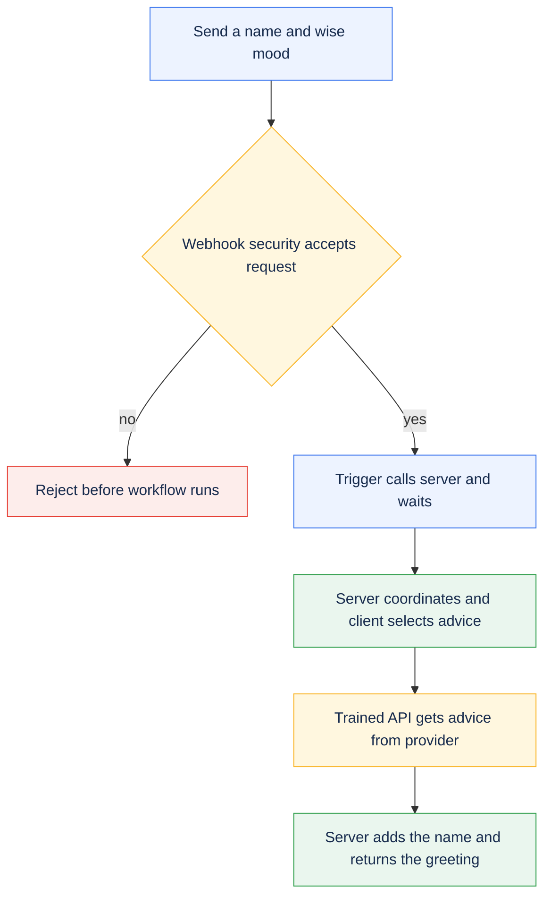
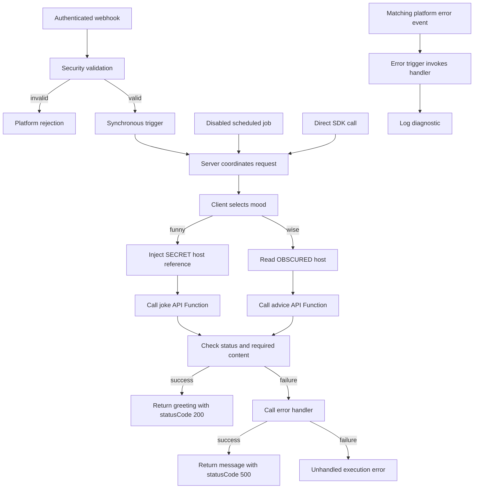

# Message of the day: your first PolyAPI workflow

Build a protected endpoint that greets someone with advice or a joke. This lesson
introduces webhooks, triggers, server and client functions, trained API Functions,
and Vari. After your first request works, explore validation, errors, and the
optional scheduled job.

New to the template? Complete [Getting started](../../../README.md#getting-started)
first. Open a Bash terminal in your **project root**: the folder containing
`package.json`, `cli/`, and `workflows/`. Run all terminal commands below from
that folder. File settings and Canopy values are labeled separately.

Using a coding agent? Kickstart installs the relevant skills. For a manual
checkout, follow [agent skills setup](../../../docs/SETUP.md#agent-skills) if you
want agent assistance. You can complete this lesson without an agent.

## What you are building

Your first request follows the advice path:



**Flow** is this project's command-line tool for creating and updating resources
in PolyAPI. The **generated SDK** gives you TypeScript functions for those
resources, such as `poly.*` calls and `vari.*` configuration reads. **Vari** stores
configuration values; **Canopy** is the PolyAPI web interface used below to
manage them. The **PolyAPI runtime** hosts the endpoint and server functions;
client helpers run in their caller's process.

Here, **training an API** means reading its OpenAPI description and creating a
function that your code can call. Training does not call the external API, and
is separate from the [Weather AI lesson](../sampleAiFx/OVERVIEW.md).

| Building block | Why it exists in this sample | Read the implementation |
| --- | --- | --- |
| Webhook and security function | Accept authenticated HTTP requests and reject invalid input | [Webhook](artefacts/webhooks/motdWebhook.json), [validator](server/validateMotdPayload.ts) |
| Trigger | Route the webhook to a function and wait for its result | [Webhook trigger](artefacts/triggers/motdTrigger.json) |
| Server function | Coordinate the request and choose the response | [motdServer](server/motdServer.ts) |
| Client function | Select an API by mood and check its result | [motdClient](client/motdClient.ts) |
| API Functions | Make the outbound joke/advice HTTP calls through PolyAPI | [Joke spec](artefacts/specs/jokeApi.yaml), [advice spec](artefacts/specs/adviceApi.yaml) |
| Vari | Demonstrate protected injection and readable configuration | [SECRET joke config](artefacts/vari/jokeApiConfig.json), [OBSCURED advice config](artefacts/vari/adviceApiConfig.json) |
| Error handler and job | Explore failure handling and scheduled calls | [Error handler](server/motdErrorHandler.ts), [error trigger](artefacts/triggers/motdErrorHandlerTrigger.json), [job](artefacts/jobs/motdSchedulerJob.json) |

## Run your first request

### 1. Confirm setup and namespace

Use a development environment with permission to manage the sample resources,
generate the SDK, and execute functions. Setup saves the verified `TARGET_ENV_ID`
in the selected Flow environment file.

This tutorial assumes you are using `example` as your namespace in
`workflows/dev.env`. **Check this setting in the file**, rather than entering it
as a terminal command:

```env
POLYAPI_NAMESPACE=example
```

A namespace groups your project's functions and other resources in PolyAPI.
The names in this tutorial must match that setting: for example,
`example.sampleWorkflow` belongs to the `example` namespace.

If you used **kickstart**, this guide and the sample files already use the
namespace you chose. You can continue with those values.

If you set up manually and chose a different namespace, follow the
[manual namespace setup](../../../docs/SETUP.md#manual-setup)
before continuing. It updates the starter code and tutorial examples to match.
Changing `POLYAPI_NAMESPACE` in `dev.env` alone does not update those files.
For an existing customized or deployed project, see
[changing a namespace](../../../docs/CONVENTIONS.md#namespaces-and-portable-references).

**In your terminal**, select your environment file once per session:

```bash
export ENVPATH=workflows/dev.env
```

Use your setup-selected file if different. TypeScript Flow also accepts
`export ENVPATH=dev.env`: it looks in `workflows/` first for a bare filename.
Without `ENVPATH`, it defaults to `workflows/dev.env`. Exporting the path selects
the file for Flow; it does not export that file's contents into your shell.

**Checkpoint:** the namespace in your environment file matches the first part
of the sample's context (`example.sampleWorkflow`) and its SDK calls
(`poly.example.sampleWorkflow` and `vari.example.sampleWorkflow`). Keep the
`TARGET_ENV_ID` saved during setup in that file. Flow checks it before remote
commands, including deployment previews. Keep real environment files out of Git.

### 2. Train the two outbound APIs

An OpenAPI specification describes an HTTP API. Training makes that API
available as functions your workflow can call. Train **both** bundled
specifications: the client function refers to both APIs even though your first
request will use only advice.

This folder also has older JSON reference files. Select the two YAML
specifications below to avoid processing duplicate APIs.

**In your terminal**, preview the two bundled API descriptions:

```bash
pnpm flow train-openapi workflows/src/sampleWorkflow/artefacts/specs/jokeApi.yaml --context example.sampleWorkflow --operation-id getRandomJoke --disable-ai --dry-run
pnpm flow train-openapi workflows/src/sampleWorkflow/artefacts/specs/adviceApi.yaml --context example.sampleWorkflow --operation-id getRandomAdvice --disable-ai --dry-run
```

**Check the preview:** it should pair `jokeApi.yaml` with `getRandomJoke` and
`adviceApi.yaml` with `getRandomAdvice`, both under `example.sampleWorkflow`.
These commands check local inputs only; they do not create functions in PolyAPI.
Each preview reports that no models were written or trained.

**In your terminal**, register both APIs once the preview is correct:

```bash
pnpm flow train-openapi workflows/src/sampleWorkflow/artefacts/specs/jokeApi.yaml --context example.sampleWorkflow --operation-id getRandomJoke --disable-ai
pnpm flow train-openapi workflows/src/sampleWorkflow/artefacts/specs/adviceApi.yaml --context example.sampleWorkflow --operation-id getRandomAdvice --disable-ai
```

Real training verifies the target, translates each spec with a `hostUrl`
argument, saves its model, creates the API Functions, and regenerates the SDK.
`--disable-ai` skips optional AI-generated descriptions and names, retaining
the translator's names. Training does not call the joke or advice provider.

**Checkpoint — files:** these new files appear next to the original API
descriptions. A **model** is the generated JSON description of the resources
PolyAPI will register. Open each file in your editor and check the `name` and
`context` in its `functions` array:

| Generated file, relative to the project root | Expected function name | Expected context |
| --- | --- | --- |
| `workflows/src/sampleWorkflow/artefacts/specs/jokeApi.poly.json` | `getRandomJoke` | `example.sampleWorkflow` |
| `workflows/src/sampleWorkflow/artefacts/specs/adviceApi.poly.json` | `getRandomAdvice` | `example.sampleWorkflow` |

**Checkpoint — SDK:** open [motdClient](client/motdClient.ts) in your editor and
use **Go to Definition** on `getRandomAdvice` and `getRandomJoke`. The expected
calls are `poly.example.sampleWorkflow.getRandomAdvice(hostUrl)` and
`poly.example.sampleWorkflow.getRandomJoke(hostUrl)`. Each name should resolve to
its generated TypeScript declaration, with a `hostUrl` argument. An offline
preview alone cannot generate these declarations. See
[training and SDK reference](#training-and-sdk-reference) if a name is missing
or models already exist when you retry.

### 3. Preview and deploy the workflow

Use a branch based on `develop`; see [development branches](#development-branches)
if your checkout is not already configured. **In your terminal**, preview this
sample's deployment:

```bash
pnpm workflows push --dry-run --paths sampleWorkflow
```

**Check the preview:** confirm the intended environment and namespace. The plan
should include the sample's two variables, four functions, webhook, two
triggers, and disabled job. The job should stay disabled while you learn the
request flow.

**In your terminal**, deploy the workflow once the plan is correct:

```bash
pnpm workflows push --paths sampleWorkflow
```

Flow verifies the environment for both commands and normally regenerates the
SDK after deployment. It orders resources by dependency; a push does not train
APIs from the specs folder. Keep the branch, target, and OTP safeguards in place.

**Checkpoint:** deployment completes without errors. In Canopy, select the same
environment and confirm the resources appear under `example.sampleWorkflow`.
Your first request uses `wise`, which reads the public host already stored in
`adviceApiConfig`. You can configure the joke branch's secret
[after this first request](#5-configure-injection-and-try-a-joke).

### 4. Invoke the advice path

**In Canopy**, select the environment used for deployment and open the webhook
named `motdWebhook` under `example.sampleWorkflow`. Copy its **full URL**, including
the environment subdomain; do not build it from the gateway base URL or the path
in its JSON file. These direct HTTP requests use the URL and key you supply;
they do not run Flow's target check.

**In your terminal**, run these prompts. Paste the complete deployed webhook
URL and a PolyAPI key for that same environment, pressing Enter after each.
The key stays hidden while you enter it:

```bash
read -r -p "Paste the full deployed webhook URL: " POLY_TEST_WEBHOOK_URL
read -r -s -p "Paste the PolyAPI key for that environment: " POLY_API_KEY
printf '\n'
```

These values stay in this shell session; do not save them in tracked files.
A value in an env file does not automatically become a Bash variable.

**In your terminal**, send the request from the same session. `curl -i` shows
the HTTP status as well as the JSON body:

```bash
curl -i -X POST "$POLY_TEST_WEBHOOK_URL" \
  --header 'Content-Type: application/json' \
  --header "Authorization: Bearer $POLY_API_KEY" \
  --data '{ "name": "Ada", "mood": "wise" }'
```

Expect a body with this shape; the advice text varies:

```json
{ "statusCode": 200, "message": "Hi Ada! <advice returned by the provider>" }
```

**Checkpoint:** the message starts with `Hi Ada!` and includes advice. Provider
text changes between calls. You have exercised webhook → security function →
trigger → server → client → trained API Function. Find `motdServer` in Canopy to
inspect its logs; `motdClient` runs inside that server function and has no
separate log stream. The advice configuration ships with its public host URL,
so this path needs no extra provider account or secret.

**Your first integration works.** You can stop here or continue below to learn
how to use secrets and change the sample.

### 5. Configure injection and try a joke

This is an optional next step after the advice request succeeds.

**In Canopy**, open `jokeApiConfig` under `example.sampleWorkflow` in the same
environment. Set its value as an **Object**. Paste this JSON as the variable's
value, not into your terminal:

```json
{ "hostUrl": "https://official-joke-api.appspot.com" }
```

This URL is public, but the sample deliberately stores it as `SECRET` to teach
injection. Its JSON artefact has no value, so deployment alone does not populate
it. The API Function receives the injected `hostUrl`; the client function does
not read the secret itself. See [Vari details](#vari-details) for how the two
configuration values differ.

Repeat the request from [step 4](#4-invoke-the-advice-path) with
`"mood": "funny"` and the original `"name": "Ada"`. Expect a greeting that joins
a joke's setup and punchline:

```json
{ "statusCode": 200, "message": "Hi Ada! <setup> ... <punchline>" }
```

**Checkpoint:** `.inject("hostUrl")` passes an opaque reference to the API
Function. The platform resolves it at that boundary; the client never reads
the SECRET value.

## Try it yourself

These exercises are optional. Start with the small greeting change, then explore
the other behavior when you are ready.

- In [motdServer](server/motdServer.ts), change the greeting from
  `Hi` to `Hello`. Repeat the [deployment preview and push](#3-preview-and-deploy-the-workflow),
  then send the [advice request](#4-invoke-the-advice-path) again. You should now
  see `Hello Ada!` followed by the advice. Restore `Hi` and redeploy afterward
  so the response examples still match.
- Change `Ada` to your name and switch between `wise` and `funny`. Trace the two
  branches in [motdClient](client/motdClient.ts).
- Send a whitespace-only name or `"mood": "sleepy"`. Expect rejection before the
  main server runs; inspect both the HTTP status and the platform's response.
  The webhook supplies `Invalid or missing field in event payload.` as its
  rejection message.
- Explain why advice uses a read while the joke uses injection. Neither value
  is cached, and only one can be read by the client.
- Read the [scheduled job](artefacts/jobs/motdSchedulerJob.json). It calls the
  server directly every 60 minutes with `Scheduler` / `wise`, bypassing webhook
  security. Leave the job disabled unless you intend recurring calls.
- Follow the provider-failure branch in [motdClient](client/motdClient.ts) and
  the `catch` block in [motdServer](server/motdServer.ts). Observe how an invalid
  API result becomes a handled response through the error handler.

## Runtime reference

The remaining sections are reference material for understanding or extending
the working sample; they are not extra steps needed for your first request.

### Request and response



The [webhook](artefacts/webhooks/motdWebhook.json) hosts
`POST /apis/sample-workflow-motd/motd`, requires a PolyAPI key, and declares the
payload schema. Its [security function](server/validateMotdPayload.ts) returns
`false` when the name is missing or blank, or the mood is not `funny` or `wise`.
PolyAPI constructs the rejection response before the trigger fires.

The [trigger](artefacts/triggers/motdTrigger.json) uses `waitForResponse: true`
to return the server's result to the caller. The
[server](server/motdServer.ts) accepts one `eventPayload` argument and calls
[motdClient](client/motdClient.ts) through the generated SDK. A client function
runs in its caller's process; here its logs belong to `motdServer`, with no
separate hosted client execution or log stream.

The installed SDK returns API HTTP/transport failures as results with `status`
and `data`. The client checks for a 2xx status and the expected content:
`setup` / `punchline` for a joke, or `slip.advice` for advice. An unsuitable
result throws; the server's `catch` block handles that failure.

Each deployable `.ts` file carries its own `polyConfig` export. This sample has
no metadata sidecar JSON files or separate `artefacts/schemas/` folder: the
webhook declares its input schema. It keeps no persisted state and uses no Tabi
tables. See the [artefact conventions](../../../docs/CONVENTIONS.md#artefacts)
and platform [function types](https://docs.polyapi.io/functions/index.html) /
[client-function guide](https://docs.polyapi.io/generated_sdks/client_functions.html)
for the wider resource model and execution boundaries.

### Error handling

The [error handler](server/motdErrorHandler.ts) has two callers with different
payload shapes, so its input fields are optional. It uses the supplied function
name or `unknown function`, builds a message from the error detail, logs it,
and returns it.

When the client throws, the server calls this handler directly from its `catch`
block. If the handler succeeds, the server returns a body like:

```json
{ "statusCode": 500, "message": "motd request failed in motdClient: getRandomAdvice failed with status 500" }
```

`statusCode` is application data here. `motdServer` does not set
`polyCustom.responseStatusCode`, so a body containing `500` does not by itself
set HTTP status 500 or mark a scheduled execution as failed. This response
depends on the handler call succeeding; the handler's own failure remains
unhandled. Platform rejection and uncaught-error responses are separate.

The [error trigger](artefacts/triggers/motdErrorHandlerTrigger.json) independently
selects platform error events on `/apis/sample-workflow-motd/motd`. It has a
`path` filter and no `functionIds` filter. Its return value does not shape the
response produced by the server's direct handler call. Catching an SDK error
does not establish whether a remote error event was already emitted or whether
nested failures match that path. Verify matching and delivery in development;
see the [error-trigger guide](https://docs.polyapi.io/error_handlers/error-handler-trigger.html).

### Scheduled calls

The [job](artefacts/jobs/motdSchedulerJob.json) calls `motdServer` directly every
60 minutes with `{ name: "Scheduler", mood: "wise" }`. It ships with
`enabled: false`, so it does nothing until deliberately enabled and redeployed.
No webhook, webhook security check, or HTTP request participates in this path.
The server uses the supplied payload; its TypeScript type does not add runtime
validation to a direct call.

The server can call the error handler for a scheduled failure, just as it does
for a webhook request. A returned `statusCode: 500` is still application data;
the path-filtered platform error trigger does not establish coverage for the
scheduled entrypoint.

## Verification

Use the requests in [step 4](#4-invoke-the-advice-path) and
[step 5](#5-configure-injection-and-try-a-joke) to check both deployed paths.
Then send the invalid input from [Try it yourself](#try-it-yourself) and confirm
that webhook security rejects it before the main server runs. Inspect the HTTP
status as well as the response body, and find `motdServer` in Canopy to view its
logs. The separate error handler has its own logs.

For the template's shared utilities, local checks are available with:

```bash
pnpm workflows test
```

Those tests use mocked SDK calls to check utility behavior. They do not exercise
this deployed webhook or prove live secret resolution. The direct HTTP requests
above use the URL and key you provide, without Flow's `TARGET_ENV_ID` check.
Confirm both belong to the intended development environment.

To verify the platform error trigger, use a separate, deliberately failing
development fixture and inspect the handler's logs. A handled response alone
cannot establish whether a matching platform error event was delivered.

## Troubleshooting

| Symptom | Check |
| --- | --- |
| Generated function missing | Confirm training, namespace, and generation all used the same environment; inspect the translated names. |
| Target mismatch | Check the selected Flow file and authenticated identity; preserve the target pin. |
| `wise` works, `funny` fails | Set the SECRET Object value in Canopy and check the API Function's `hostUrl` argument. |
| Advice configuration error | Confirm the OBSCURED object contains a nonempty `hostUrl`. |
| Request rejected | Check the full deployed URL, matching key, nonblank name, and allowed mood. |
| Body contains `statusCode: 500` | Inspect the HTTP status and error-handler logs; check provider status and required fields. |
| Model already exists | Inspect and train the saved `.poly.json` model, or deliberately regenerate with `--overwrite-model`. |
| No client-function logs | Inspect the parent `motdServer` logs. The separate error handler has its own logs. |

## Training and SDK reference

The YAML specs' operation IDs declare the expected API names. Selecting those
operations avoids training other operations from the same specification.
Optional AI enrichment can change names, descriptions, and arguments; omit
`--disable-ai` only when you intend to review those changes. `--generate-only`
saves a translated model for review but still calls the platform and, unless
disabled, its AI enrichment service.

Use `train-model` to retry a saved `.poly.json` model. Regeneration from a spec
requires `--overwrite-model`; `--rename FROM TO` can align changed identifiers.
The older [official-joke-api.json](artefacts/specs/official-joke-api.json) and
[advice-slip-api.json](artefacts/specs/advice-slip-api.json) files are historical
reference models, not current training output or proof the functions exist in
your environment. See [Flow training](../../../cli/README.md#openapi-training).

Flow normally generates the SDK after successful training and pushes. For a
separate refresh, first confirm the native SDK connection, then run:

```bash
pnpm workflows exec poly generate
```

This native command uses the workflow SDK's selected connection. It does not
load Flow's `ENVPATH` or enforce `TARGET_ENV_ID`. Use the same environment as
training and deployment. After generation, open [motdClient](client/motdClient.ts)
and use **Go to Definition** on the two trained calls to inspect their names
and `hostUrl` arguments. If they are missing, check the training output and
model files before retrying. Change source specifications and regenerate rather
than editing generated declarations.

### Vari details

Vari secrecy levels control how code and humans can access a stored value.
The platform supports `NONE`, `OBSCURED`, `SECRET`, and `PARTIAL`; this sample
uses two levels to demonstrate the difference, even though both values are
public API base URLs.

The [joke config](artefacts/vari/jokeApiConfig.json) is SECRET. Its `.inject()`
reference must go unchanged into `getRandomJoke`; the API Function's gateway
boundary resolves it. A client function cannot resolve an injected value or
read the secret itself with `.get()`.

The [advice config](artefacts/vari/adviceApiConfig.json) is OBSCURED and starts
with `{ "hostUrl": "https://api.adviceslip.com" }`. It permits runtime reads
while masking the UI. Here `.get()` returns an object and the client reads its
`hostUrl` property on every request. Neither configuration nor the injection
reference is cached. Both upstream APIs are public and need no account or API key.

### Development branches

Kickstart creates `develop`. For a manual checkout, create it once from `main`
with `git switch -c develop main` if needed. To start a feature:

```bash
git switch develop
git switch -c feature/my-workflow
```

The default branch settings associate `develop` with `dev.env` and `main` with
`prod.env`. Flow checks branch ancestry and prompts when the selected file does
not match the branch's expected environment. Review the selected target and
preview instead of bypassing those checks; the selected file's verified target
pin still applies.

A full push also includes [common utilities](../utilities/common/OVERVIEW.md) and
[Weather AI](../sampleAiFx/OVERVIEW.md). Configure their dependencies before
invoking them; keep this lesson's push scoped to `sampleWorkflow` while learning.
